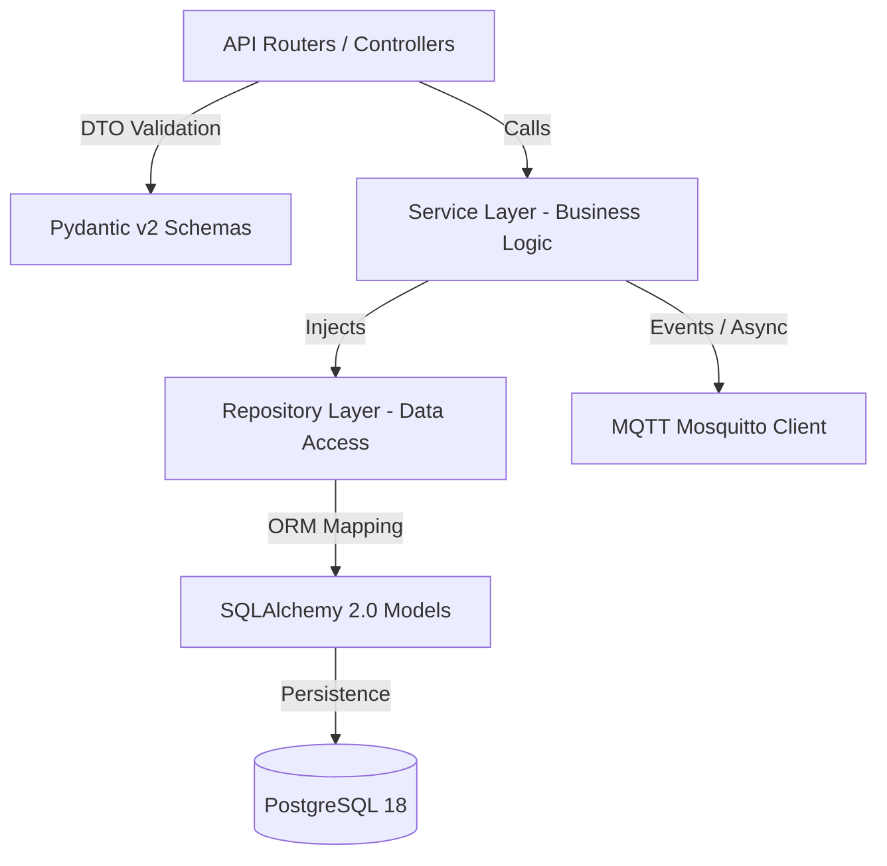

# Arsitektur Berorientasi Objek (OOP) & Standar Struktur Direktori SADITA.ai

Dokumen ini adalah standar resmi arsitektur perangkat lunak untuk seluruh pengembangan backend (FastAPI/Python) dan frontend (Next.js/TypeScript) pada platform SADITA.ai. Seluruh developer dan agen AI wajib mematuhi panduan ini guna memastikan basis kode mudah dipelihara (*maintainable*), mudah diuji (*testable*), memiliki skalabilitas tinggi (*scalable*), dan mematuhi prinsip SOLID serta Clean Architecture.

---

## 1. Prinsip Utama Desain OOP & SOLID

SADITA.ai dibangun dengan paradigma **Object-Oriented Programming (OOP)** murni yang dipadukan dengan **Domain-Driven Design (DDD)** dan **Layered Architecture**. Setiap komponen perangkat lunak harus mematuhi 5 prinsip SOLID:

### 1.1 Single Responsibility Principle (SRP)
- Setiap kelas, modul, atau fungsi hanya boleh memiliki **satu alasan untuk berubah**.
- Controller/Router hanya bertugas menerima HTTP request, validasi skema DTO, dan mengembalikan HTTP response. Controller **dilarang keras** memuat query database langsung atau kalkulasi bisnis.
- Service Layer mengelola logika bisnis dan koordinasi alur kerja (orchestration).
- Repository Layer bertanggung jawab penuh atas manipulasi dan persistensi data (CRUD dan query SQL).

### 1.2 Open/Closed Principle (OCP)
- Entitas perangkat lunak harus **terbuka untuk perluasan (open for extension)** tetapi **tertutup untuk modifikasi (closed for modification)**.
- Gunakan Abstract Base Classes (ABC) di Python dan TypeScript Interfaces. Penambahan fungsionalitas baru (misal: metode autentikasi presensi baru seperti Face Recognition atau QR-Dynamic) dilakukan dengan membuat kelas baru yang mengimplementasikan interface terkait tanpa merusak kode presensi RFID/Fingerprint yang sudah ada.

### 1.3 Liskov Substitution Principle (LSP)
- Subkelas atau implementasi konkrit harus dapat menggantikan kelas induknya (base class/interface) tanpa mengubah kebenaran perilaku program.
- Contoh: Setiap repository konkrit (misal `StudentRepository`, `AttendanceRepository`) yang mewarisi `BaseRepository[T]` harus mematuhi kontrak method `get_by_id`, `create`, `update`, `delete`, dan `list`.

### 1.4 Interface Segregation Principle (ISP)
- Klien tidak boleh dipaksa bergantung pada antarmuka (interface) yang tidak digunakannya.
- Pecah interface besar menjadi interface-interface yang lebih spesifik dan modular (misal: `ReadableRepository`, `WritableRepository`, `AuditableRepository`).

### 1.5 Dependency Inversion Principle (DIP)
- Modul tingkat tinggi (High-level modules) tidak boleh bergantung langsung pada modul tingkat rendah (Low-level modules). Keduanya harus bergantung pada abstraksi (abstractions/interfaces).
- Gunakan pola **Dependency Injection (DI)** bawaan FastAPI (`Depends`) pada backend dan Context/Custom Hooks pada frontend.

---

## 2. Arsitektur Backend (FastAPI + SQLAlchemy 2.0 + Pydantic v2)

Backend mengadopsi struktur 4-lapisan (*4-Tier Clean Architecture*):



### 2.1 Pola Base Repository Generic (OOP)
Semua akses data wajib melalui repository yang mewarisi `BaseRepository`. Pola ini menghindari duplikasi kode SQL/ORM dan menyatukan penanganan transaksi.

```python
# File: backend/app/repositories/base.py
from typing import Generic, TypeVar, Type, Optional, List, Any, Dict, Union
from sqlalchemy.orm import Session
from sqlalchemy import select, update, delete, func
from pydantic import BaseModel
from app.db.base import Base

ModelType = TypeVar("ModelType", bound=Base)
CreateSchemaType = TypeVar("CreateSchemaType", bound=BaseModel)
UpdateSchemaType = TypeVar("UpdateSchemaType", bound=BaseModel)

class BaseRepository(Generic[ModelType, CreateSchemaType, UpdateSchemaType]):
    """
    Kelas dasar berorientasi objek untuk seluruh operasi CRUD database.
    Menerapkan enkapsulasi penuh terhadap query SQLAlchemy.
    """
    def __init__(self, model: Type[ModelType]):
        self._model = model

    @property
    def model(self) -> Type[ModelType]:
        return self._model

    def get_by_id(self, db: Session, id: Any) -> Optional[ModelType]:
        stmt = select(self._model).where(self._model.id == id)
        return db.execute(stmt).scalars().first()

    def list(
        self,
        db: Session,
        *,
        skip: int = 0,
        limit: int = 100,
        filters: Optional[Dict[str, Any]] = None
    ) -> List[ModelType]:
        stmt = select(self._model)
        if filters:
            for field, value in filters.items():
                if hasattr(self._model, field) and value is not None:
                    stmt = stmt.where(getattr(self._model, field) == value)
        stmt = stmt.offset(skip).limit(limit)
        return list(db.execute(stmt).scalars().all())

    def count(self, db: Session, *, filters: Optional[Dict[str, Any]] = None) -> int:
        stmt = select(func.count()).select_from(self._model)
        if filters:
            for field, value in filters.items():
                if hasattr(self._model, field) and value is not None:
                    stmt = stmt.where(getattr(self._model, field) == value)
        return db.execute(stmt).scalar_one()

    def create(self, db: Session, *, obj_in: Union[CreateSchemaType, Dict[str, Any]]) -> ModelType:
        if isinstance(obj_in, dict):
            create_data = obj_in
        else:
            create_data = obj_in.model_dump(exclude_unset=True)
        db_obj = self._model(**create_data)
        db.add(db_obj)
        db.commit()
        db.refresh(db_obj)
        return db_obj

    def update(
        self,
        db: Session,
        *,
        db_obj: ModelType,
        obj_in: Union[UpdateSchemaType, Dict[str, Any]]
    ) -> ModelType:
        if isinstance(obj_in, dict):
            update_data = obj_in
        else:
            update_data = obj_in.model_dump(exclude_unset=True)
        for field, value in update_data.items():
            if hasattr(db_obj, field):
                setattr(db_obj, field, value)
        db.add(db_obj)
        db.commit()
        db.refresh(db_obj)
        return db_obj

    def delete(self, db: Session, *, id: Any) -> Optional[ModelType]:
        obj = self.get_by_id(db, id)
        if obj:
            db.delete(obj)
            db.commit()
        return obj
```

### 2.2 Pola Service Layer Berorientasi Objek
Semua aturan bisnis, validasi multi-tabel, permission checking, dan audit trail diletakkan di Service Layer:

```python
# File: backend/app/services/base.py
from typing import Generic, TypeVar, Optional, List, Any, Dict
from sqlalchemy.orm import Session
from app.repositories.base import BaseRepository
from app.core.exceptions import NotFoundException, BusinessRuleException

RepoType = TypeVar("RepoType", bound=BaseRepository)

class BaseService(Generic[RepoType]):
    """
    Kelas dasar service layer yang mengelola transaksi bisnis dan otorisasi.
    """
    def __init__(self, repository: RepoType):
        self._repo = repository

    @property
    def repository(self) -> RepoType:
        return self._repo

    def get_or_404(self, db: Session, entity_id: Any, entity_name: str = "Entitas") -> Any:
        entity = self._repo.get_by_id(db, entity_id)
        if not entity:
            raise NotFoundException(f"{entity_name} dengan ID {entity_id} tidak ditemukan.")
        return entity
```

---

## 3. Arsitektur Frontend (Next.js 16 + React 19 + TypeScript)

Frontend menggunakan pendekatan berorientasi komponen (*Component-Driven Architecture*) dengan modularitas tinggi, tipe TypeScript ketat, serta pemisahan murni antara presentasi dan data-fetching.

### 3.1 Pola Service HTTP & API Client Berorientasi Objek
Koneksi ke backend dibungkus ke dalam kelas API Service yang memiliki enkapsulasi token JWT, auto-refresh token, dan standard error handling:

```typescript
// File: frontend/lib/services/base-api.service.ts
export interface ApiResponse<T> {
  success: boolean;
  statusCode: number;
  message: string;
  data: T;
  meta?: {
    page: number;
    limit: number;
    total: number;
    totalPages: number;
  };
}

export abstract class BaseApiService {
  protected readonly baseUrl: string;

  constructor(resourcePath: string) {
    this.baseUrl = `${process.env.NEXT_PUBLIC_API_URL || 'http://localhost:8000/api/v1'}/${resourcePath}`;
  }

  protected async getHeaders(customHeaders: HeadersInit = {}): Promise<Headers> {
    const headers = new Headers({
      'Content-Type': 'application/json',
      'Accept': 'application/json',
      ...customHeaders,
    });

    if (typeof window !== 'undefined') {
      const token = localStorage.getItem('access_token');
      if (token) {
        headers.set('Authorization', `Bearer ${token}`);
      }
    }
    return headers;
  }

  protected async handleResponse<T>(res: Response): Promise<ApiResponse<T>> {
    if (!res.ok) {
      if (res.status === 401 && typeof window !== 'undefined') {
        // Handle token refresh or redirect to login
        window.dispatchEvent(new CustomEvent('sadita:unauthorized'));
      }
      const errorData = await res.json().catch(() => ({ message: 'Terjadi kesalahan sistem.' }));
      throw new Error(errorData.message || `HTTP Error ${res.status}`);
    }
    return res.json();
  }

  public async get<T>(endpoint = '', params?: Record<string, any>): Promise<ApiResponse<T>> {
    const url = new URL(`${this.baseUrl}${endpoint ? `/${endpoint}` : ''}`);
    if (params) {
      Object.entries(params).forEach(([key, val]) => {
        if (val !== undefined && val !== null) {
          url.searchParams.append(key, String(val));
        }
      });
    }
    const headers = await this.getHeaders();
    const res = await fetch(url.toString(), { method: 'GET', credentials: 'include', headers });
    return this.handleResponse<T>(res);
  }

  public async post<T>(endpoint = '', payload: any): Promise<ApiResponse<T>> {
    const headers = await this.getHeaders();
    const res = await fetch(`${this.baseUrl}${endpoint ? `/${endpoint}` : ''}`, {
      method: 'POST',
      credentials: 'include',
      headers,
      body: JSON.stringify(payload),
    });
    return this.handleResponse<T>(res);
  }
}
```

---

## 4. Standar Penamaan & Struktur Direktori Lengkap

Struktur direktori harus konsisten, intuitif, dan memudahkan navigasi baik bagi developer manusia maupun agen otomatis.

### 4.1 Konvensi Penamaan (Naming Conventions)
1. **Direktori & Folder**: Selalu gunakan `kebab-case` untuk folder frontend (contoh: `course-material`, `attendance-list`) dan `snake_case` untuk folder backend Python (contoh: `attendance_engine`, `mqtt_handlers`).
2. **File Backend Python**: Gunakan `snake_case.py` (contoh: `student_repository.py`, `grading_service.py`).
3. **Kelas Backend Python**: Gunakan `PascalCase` (contoh: `StudentRepository`, `AttendanceSessionService`).
4. **File Komponen Frontend**: Gunakan `kebab-case.tsx` untuk file (contoh: `attendance-table.tsx`, `stat-card.tsx`) dan `PascalCase` untuk nama fungsi komponen (`AttendanceTable`, `StatCard`).
5. **Types / Interfaces**: Gunakan `PascalCase` dengan deskripsi jelas (contoh: `StudentProfile`, `CourseSession`, `AttendanceFilterParams`). Hindari prefix `I` seperti `IStudent`.
6. **Constants / Enums**: Gunakan `UPPER_SNAKE_CASE` (contoh: `KTMStatus.KTM_TERDAFTAR`, `AttendanceMethod.RFID`).

### 4.2 Blueprint Struktur Folder Proyek

```
sadita.ai/
├── .agents/                               # Antigravity Workspace Customizations
│   ├── AGENTS.md                          # Master Project Rules (Preserved L1-417 + Extensions)
│   ├── anti-slop/                         # Standar Desain Human-Crafted & Anti-AI Slop
│   │   └── ANTI_SLOP_DESIGN_GUIDELINES.md
│   ├── dealtech-ui/                       # Design System, Breakpoints & Apple iOS Support
│   │   └── DESIGN_SYSTEM_AND_RESPONSIVE_SPEC.md
│   ├── dealtech-ui-for-public-component/  # Reusable UI Primitives & 100% SEO Standards
│   │   └── REUSABLE_COMPONENTS_AND_SEO_SPEC.md
│   ├── learnstack-lms/                    # Domain LMS, Akademik, dan Grading Engine
│   │   └── LMS_AND_ATTENDANCE_DOMAIN_SPEC.md
│   └── sadita/                            # Arsitektur Inti, Security, dan Reusability
│       ├── OOP_ARCHITECTURE_AND_FOLDER_STRUCTURE.md
│       ├── ZERO_TRUST_SECURITY_SPECIFICATION.md
│       └── REUSABLE_ENGINEERING_AND_DRY_STANDARDS.md
│
├── backend/                               # FastAPI Application
│   ├── alembic/                           # Database Migrations (PostgreSQL)
│   │   ├── versions/                      # Migration Scripts
│   │   └── env.py
│   ├── app/
│   │   ├── api/                           # Endpoint Controllers (Routers)
│   │   │   ├── v1/
│   │   │   │   ├── router.py              # Aggregator Router v1
│   │   │   │   ├── auth.py                # Login, Refresh, Logout, Profile
│   │   │   │   ├── academic.py            # Prodi, Matkul, Kelas, KRS
│   │   │   │   ├── attendance.py          # Session, Live Tap, Manual Correction
│   │   │   │   ├── devices.py             # ESP32-S3 Hardware Management
│   │   │   │   ├── lms.py                 # Pertemuan, Materi, Tugas, Submission
│   │   │   │   ├── grading.py             # Nilai & Rekapitulasi
│   │   │   │   ├── approval.py            # Verifikasi Pengganti & Admin Approval
│   │   │   │   └── audit.py               # Audit Trails & System Logs
│   │   ├── core/                          # Cross-cutting Concerns
│   │   │   ├── config.py                  # Pydantic Settings & Env Vars
│   │   │   ├── security.py                # Password Hashing, JWT RS256/HS256
│   │   │   ├── deps.py                    # FastAPI Dependency Injections
│   │   │   ├── exceptions.py              # Custom Exception Classes
│   │   │   └── middleware.py              # Security Headers, Rate Limiting, Request ID
│   │   ├── db/                            # Database Infrastructure
│   │   │   ├── base.py                    # SQLAlchemy Declarative Base
│   │   │   ├── session.py                 # SessionFactory & Asyncpg/psycopg2 Pool
│   │   │   └── init_db.py                 # Seeding & Initial Schemas
│   │   ├── models/                        # SQLAlchemy 2.0 ORM Entities
│   │   │   ├── user.py                    # User, Role, Permission
│   │   │   ├── academic.py                # Prodi, Semester, Matkul, Class, KRS
│   │   │   ├── attendance.py              # AttendanceSession, AttendanceRecord
│   │   │   ├── device.py                  # Device, DeviceAssignment
│   │   │   ├── lms.py                     # SessionTopic, Material, Assignment, Submission
│   │   │   └── audit.py                   # AuditLog
│   │   ├── repositories/                  # Data Access Layer (OOP Repos)
│   │   │   ├── base.py                    # Generic BaseRepository[T]
│   │   │   ├── user_repository.py
│   │   │   ├── academic_repository.py
│   │   │   ├── attendance_repository.py
│   │   │   ├── device_repository.py
│   │   │   └── lms_repository.py
│   │   ├── schemas/                       # Pydantic v2 DTOs (Request / Response)
│   │   │   ├── common.py                  # ApiResponse, PaginatedMeta
│   │   │   ├── auth.py
│   │   │   ├── academic.py
│   │   │   ├── attendance.py
│   │   │   ├── device.py
│   │   │   └── lms.py
│   │   ├── services/                      # Business Logic Layer (OOP Services)
│   │   │   ├── base.py                    # BaseService
│   │   │   ├── auth_service.py
│   │   │   ├── academic_service.py
│   │   │   ├── attendance_service.py
│   │   │   ├── device_service.py
│   │   │   ├── lms_service.py
│   │   │   ├── grading_service.py
│   │   │   └── audit_service.py
│   │   ├── mqtt/                          # MQTT Client & Hardware Telemetry
│   │   │   ├── client.py                  # Mosquitto Connection & TLS
│   │   │   ├── handlers.py                # Attendance Tap & Status Handlers
│   │   │   └── topics.py                  # Topic Definitions
│   │   └── main.py                        # FastAPI Application Entrypoint
│   ├── tests/                             # Automated Test Suite (Pytest)
│   │   ├── conftest.py
│   │   ├── test_auth.py
│   │   ├── test_attendance.py
│   │   └── test_grading.py
│   ├── requirements.txt                   # Pinned Dependencies
│   └── alembic.ini
│
├── frontend/                              # Next.js 16 App Router
│   ├── app/                               # Route Handlers & Server Components
│   │   ├── layout.tsx                     # Root Layout with Font & SEO Config
│   │   ├── globals.css                    # Unified Design Tokens & Reset
│   │   ├── sitemap.ts                     # Dynamic XML Sitemap Generator
│   │   ├── robots.ts                      # SEO Robots Directive
│   │   ├── manifest.ts                    # iOS PWA Web Manifest
│   │   ├── (auth)/
│   │   │   └── login/page.tsx             # Enterprise Login Portal
│   │   ├── admin/                         # Admin Dashboard & Management Pages
│   │   │   ├── layout.tsx
│   │   │   ├── page.tsx
│   │   │   ├── prodi/page.tsx
│   │   │   ├── kelas/page.tsx
│   │   │   ├── mahasiswa/page.tsx
│   │   │   ├── dosen/page.tsx
│   │   │   ├── krs/page.tsx
│   │   │   ├── perangkat/page.tsx
│   │   │   ├── presensi/page.tsx
│   │   │   └── approval/page.tsx
│   │   ├── dosen/                         # Dosen Portal
│   │   │   ├── layout.tsx
│   │   │   ├── page.tsx
│   │   │   ├── kelas/page.tsx
│   │   │   ├── presensi/page.tsx
│   │   │   ├── materi/page.tsx
│   │   │   ├── tugas/page.tsx
│   │   │   └── nilai/page.tsx
│   │   ├── kaprodi/                       # Kaprodi Monitoring Portal
│   │   │   ├── layout.tsx
│   │   │   └── page.tsx
│   │   ├── mahasiswa/                     # Mahasiswa Portal
│   │   │   ├── layout.tsx
│   │   │   ├── page.tsx
│   │   │   ├── jadwal/page.tsx
│   │   │   ├── presensi/page.tsx
│   │   │   ├── kelas/page.tsx
│   │   │   ├── tugas/page.tsx
│   │   │   └── kartu/page.tsx
│   │   └── ketua-kelas/                   # Privilege Tab: Verifikasi Sesi Pengganti
│   │       ├── layout.tsx
│   │       └── verifikasi/page.tsx
│   ├── components/                        # Reusable Component Hierarchy
│   │   ├── ui/                            # Atomic Primitives
│   │   │   ├── button.tsx
│   │   │   ├── badge.tsx
│   │   │   ├── input.tsx
│   │   │   ├── select.tsx
│   │   │   ├── modal.tsx
│   │   │   ├── data-table.tsx             # Universal Reusable Data Table
│   │   │   ├── stat-card.tsx
│   │   │   └── toast.tsx
│   │   ├── layout/                        # Layout Components
│   │   │   ├── role-shell.tsx             # Unified Navigation Shell
│   │   │   ├── sidebar.tsx
│   │   │   ├── topbar.tsx
│   │   │   └── mobile-nav.tsx             # iOS-Optimized Bottom Bar
│   │   └── domain/                        # Domain-Specific Complex Components
│   │       ├── attendance/
│   │       │   ├── live-tap-feed.tsx
│   │       │   └── manual-correction-modal.tsx
│   │       └── lms/
│   │           ├── assignment-submission.tsx
│   │           └── material-viewer.tsx
│   ├── lib/                               # Core Logic & Utilities
│   │   ├── services/                      # Typed OOP API Clients
│   │   │   ├── base-api.service.ts
│   │   │   ├── auth.service.ts
│   │   │   ├── attendance.service.ts
│   │   │   └── academic.service.ts
│   │   ├── hooks/                         # Reusable React Hooks
│   │   │   ├── use-auth.ts
│   │   │   ├── use-responsive.ts
│   │   │   └── use-table.ts
│   │   ├── utils/                         # Pure Functions
│   │   │   ├── formatters.ts              # Date, Currency, Time formatting
│   │   │   ├── security.ts                # Token & Sanitize helpers
│   │   │   └── seo.ts                     # Schema.org JSON-LD Builders
│   │   └── types/                         # Global TypeScript Definitions
│   │       ├── auth.ts
│   │       ├── academic.ts
│   │       ├── attendance.ts
│   │       └── lms.ts
│   └── package.json
│
├── firmware/                              # Hardware Firmware (ESP32-S3)
│   ├── platformio.ini
│   └── src/
│       ├── main.cpp                       # ESP32 FreeRTOS Task Scheduler
│       ├── rfid_rc522.cpp                 # RC522 SPI Reader
│       ├── fingerprint_as608.cpp          # Optical Sensor UART
│       ├── mqtt_client.cpp                # Secure MQTT over TLS
│       └── display_lcd.cpp                # I2C 16x2 / 20x4 LCD
│
└── docs/                                  # Project Documentation
    ├── ENTERPRISE_DEVELOPER_GUIDE.md
    ├── PRD.md
    └── README.md
```

---

## 5. Panduan Pemeliharaan (Maintenance Workflow)

1. **Wajib Membaca Dokumentasi Terlebih Dahulu (Read First)**: Developer atau agen AI yang baru bergabung atau belum memahami sistem SADITA.ai secara mendalam **wajib membaca dan memahami seluruh berkas dokumentasi `.md` terlebih dahulu** sebelum mulai menulis kode. Jangan berasumsi tanpa memahami alur bisnis dan arsitektur yang sudah ada.
2. **Wajib Sinkronisasi Dokumentasi Setiap Perubahan Kode (Mandatory Doc Sync)**: Setiap kali melakukan perubahan kode (fitur baru, perbaikan bug, skema database, endpoint API, atau penyesuaian UI), developer **wajib memperbarui berkas dokumentasi `.md` terkait** agar dokumentasi selalu mutakhir (*living documentation*) dan mempermudah pemeliharaan sistem di masa depan.
3. **Prinsip Perubahan Minimal**: Jangan melakukan refactoring pada file yang tidak berhubungan dengan tugas yang sedang dikerjakan.
4. **Keterbacaan dan Kode Bersih**: Kode harus mengekspresikan maksudnya sendiri (*self-documenting*). Hindari komentar klise yang sekadar mengulang kode.
5. **Pemberian Tipe Lengkap**: Dilarang menggunakan tipe `Any` pada Python tanpa justifikasi kuat, dan dilarang menggunakan `any` pada TypeScript.
6. **Verifikasi Test Suite**: Setiap perubahan logika pada service atau repository wajib disertai penambahan unit test dan dipastikan lulus pengujian `pytest` dengan coverage memadai.
