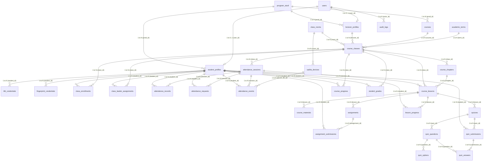

# DOKUMEN ANALISIS SISTEM BACKEND, RELASI DATABASE & ARSITEKTUR HALAMAN SADITA.AI

> **Sistem:** SADITA.ai — Sistem Akademik Terintegrasi (IoT Attendance, LMS Frappe-adapted, AI Assistant SI KOBAR)  
> **Tanggal Analisis:** 15 Oktober 2026  
> **Target Pengguna:** Administrator, Kaprodi, Dosen, Ketua Kelas, Mahasiswa  
> **Institusi:** Universitas Insan Pembangunan Indonesia (UNIPI)  

---

## DAFTAR ISI
1. [Executive Summary & Arsitektur Backend](#1-executive-summary--arsitektur-backend)
2. [Detail Relasi Antar Database (ERD & Spesifikasi Skema)](#2-detail-relasi-antar-database-erd--spesifikasi-skema)
   - 2.1 Diagram Relasi Entitas (ERD Mermaid)
   - 2.2 Kelompok Entitas 1: Core Akun, Peran, & Program Studi
   - 2.3 Kelompok Entitas 2: Profil & Hardware Credentials (IoT Multi-Credential)
   - 2.4 Kelompok Entitas 3: Struktur Akademik, Kelas, & Ruangan
   - 2.5 Kelompok Entitas 4: Mesin Presensi IoT, Sesi & Audit Trail Hardware
   - 2.6 Kelompok Entitas 5: Pembelajaran LMS (Frappe LMS Pattern Adaptation)
   - 2.7 Kelompok Entitas 6: Penilaian (Grading Engine) & Progress Belajar
   - 2.8 Kelompok Entitas 7: Workflow Approval & Audit Log
3. [Daftar Halaman Frontend per Pengguna (Role-Based Page Matrix)](#3-daftar-halaman-frontend-per-pengguna-role-based-page-matrix)
   - 3.1 Halaman Publik & Autentikasi
   - 3.2 Halaman & Fitur Pengguna: ADMIN
   - 3.3 Halaman & Fitur Pengguna: KAPRODI
   - 3.4 Halaman & Fitur Pengguna: DOSEN
   - 3.5 Halaman & Fitur Pengguna: KETUA KELAS (Delegated Leadership)
   - 3.6 Halaman & Fitur Pengguna: MAHASISWA
4. [Matriks Matriks Hak Akses Fitur (RBAC Matrix)](#4-matriks-hak-akses-fitur-rbac-matrix)
5. [Alur Logika Bisnis & Workflow Backend Kunci](#5-alur-logika-bisnis--workflow-backend-kunci)
   - 5.1 Alur Presensi IoT (RFID + Fingerprint via MQTT)
   - 5.2 Alur Presensi Online Berjenjang (Submit -> Verify -> Approve)
   - 5.3 Alur Kalkulasi Nilai Otomatis (Grading Engine)
6. [Kesimpulan & Rekomendasi Pengembangan](#6-kesimpulan--rekomendasi-pengembangan)

---

## 1. Executive Summary & Arsitektur Backend

SADITA.ai dibangun menggunakan arsitektur **Clean Modular Layered Architecture** dengan FastAPI (Python 3.10+) sebagai REST API engine, SQLAlchemy 2.0 (Mapped Column) sebagai ORM, Pydantic v2 untuk validasi data/skema, serta MQTT Broker (Eclipse Mosquitto / paho-mqtt) untuk integrasi real-time perangkat edge ESP32-S3.

```
┌────────────────────────────────────────────────────────────────────────┐
│                          PRESENTATION LAYER                            │
│           Next.js 14+ Frontend / Tailwind CSS / Dashboard UI           │
└───────────────────────────────────┬────────────────────────────────────┘
                                    │ HTTP REST / JSON (JWT Bearer)
┌───────────────────────────────────▼────────────────────────────────────┐
│                        FASTAPI GATEWAY & ROUTER                        │
│ /api/v1: auth | users | students | lecturers | academic | attendance   │
│          devices | lms | workflow | audit | health                     │
└─────────┬─────────────────────────┬─────────────────────────┬──────────┘
          │                         │                         │
┌─────────▼──────────────┐ ┌────────▼──────────────┐ ┌────────▼──────────┐
│  CORE & SECURITY       │ │  BUSINESS SERVICES    │ │  MQTT SUBSYSTEM   │
│  - JWT & PBKDF2 Hash   │ │  - AttendanceService  │ │  - paho-mqtt      │
│  - RBAC (5 Roles)      │ │  - LMSService         │ │  - ESP32 Heartbeat│
│  - Class Scoping Guard │ │  - GradingService     │ │  - Tap Event Raw  │
│  - Audit Logger        │ │  - WorkflowEngine     │ │  - LCD Response   │
└─────────┬──────────────┘ └────────┬──────────────┘ └────────┬──────────┘
          │                         │                         │
┌─────────▼─────────────────────────▼─────────────────────────▼──────────┐
│                     REPOSITORY & ORM LAYER (SQLAlchemy 2.0)            │
│  UserRepo | StudentRepo | LecturerRepo | AcademicRepo | AttendanceRepo │
│  LMSRepo  | DeviceRepo  | WorkflowRepo                                 │
└───────────────────────────────────┬────────────────────────────────────┘
                                    │
┌───────────────────────────────────▼────────────────────────────────────┐
│                  DATABASE: PostgreSQL / Relational DB                  │
│       20+ Tabel Terintegrasi (Normalized 3NF + Audit Logs)             │
└────────────────────────────────────────────────────────────────────────┘
```

### Karakteristik Kunci Backend:
1. **Multi-Role RBAC & Resource Scoping**: Memiliki 5 tingkatan pengguna (`ADMIN`, `KAPRODI`, `DOSEN`, `KETUA_KELAS`, `MAHASISWA`). Akses data tidak hanya dibatasi oleh Role, melainkan oleh *ownership* kelas (`require_class_access`).
2. **Presensi 2-Faktor IoT Terintegrasi**: Memvalidasi kartu RFID Mahasiswa (KTM) dipadukan dengan sensor biometrik Fingerprint (AS608) yang mencocokkan template slot di memori flash perangkat.
3. **Pemisahan Credential dari Profil Siswa**: Mahasiswa dapat memiliki riwayat kartu ganti/hilang tanpa merusak ID profil (`rfid_credentials` dan `fingerprint_credentials`).
4. **LMS Berstandar Frappe LMS**: Struktur materi hierarkis: Kelas -> Chapter/Module -> Lesson (Pertemuan) -> Materi/Video/Quiz/Assignment.
5. **Grading Engine Otomatis**: Formulasi nilai akhir: UTS 30% + UAS 35% + Keaktifan 10% + Tugas 15% + Absensi 10% -> Skala Huruf A, B, C, D, E.
6. **Immutable Audit Trail**: Seluruh tindakan perombakan data penting (override presensi, persetujuan online, penugasan ketua kelas, modul LMS) tersimpan di `audit_logs` dan `attendance_events`.

---

## 2. Detail Relasi Antar Database (ERD & Spesifikasi Skema)

### 2.1 Diagram Relasi Entitas (ERD Mermaid)



---

### 2.2 Kelompok Entitas 1: Core Akun, Peran, & Program Studi

#### 1. Tabel `users`
Menyimpan identitas dasar akun login, password terenkripsi, dan peran global.
* **Kolom:**
  * `id` (INTEGER, PK, Auto Increment, Index)
  * `email` (VARCHAR(255), Unique, Not Null, Index)
  * `password_hash` (VARCHAR(255), Not Null)
  * `full_name` (VARCHAR(255), Not Null)
  * `role` (ENUM: `ADMIN`, `KAPRODI`, `DOSEN`, `KETUA_KELAS`, `MAHASISWA`, Not Null, Default `MAHASISWA`)
  * `is_active` (BOOLEAN, Not Null, Default True)
  * `created_at` (TIMESTAMP WITH TIMEZONE, Not Null)
  * `updated_at` (TIMESTAMP WITH TIMEZONE, Not Null)
* **Relasi:**
  * 1-to-1 ke `student_profiles` via `user_id` (Cascade Delete)
  * 1-to-1 ke `lecturer_profiles` via `user_id` (Cascade Delete)

#### 2. Tabel `program_studi`
Menyimpan entitas jurusan/program studi akademik kampus UNIPI.
* **Kolom:**
  * `id` (INTEGER, PK, Auto Increment, Index)
  * `kode` (VARCHAR(20), Unique, Not Null, Index) — Contoh: `"TI"`, `"SI"`
  * `nama` (VARCHAR(150), Not Null) — Contoh: `"Teknik Informatika"`
  * `jenjang` (VARCHAR(10), Not Null, Default `"S1"`)
  * `is_active` (BOOLEAN, Not Null, Default True)
  * `deskripsi` (TEXT, Nullable)
* **Relasi:**
  * 1-to-N ke `student_profiles` (`prodi_id`)
  * 1-to-N ke `lecturer_profiles` (`prodi_id`)
  * 1-to-N ke `courses` (`prodi_id`)

---

### 2.3 Kelompok Entitas 2: Profil & Hardware Credentials (IoT Multi-Credential)

#### 3. Tabel `lecturer_profiles`
Profil spesifik untuk role Dosen dan Kaprodi.
* **Kolom:**
  * `id` (INTEGER, PK, Auto Increment, Index)
  * `user_id` (INTEGER, FK `users.id`, Unique, Not Null, OnDelete CASCADE)
  * `prodi_id` (INTEGER, FK `program_studi.id`, Nullable, OnDelete SET NULL)
  * `nidn` (VARCHAR(30), Unique, Not Null, Index)
  * `gelar_depan` (VARCHAR(50), Nullable) — Contoh: `"Dr."`, `"Ir."`
  * `gelar_belakang` (VARCHAR(50), Nullable) — Contoh: `"M.Kom."`, `"Ph.D."`
  * `phone` (VARCHAR(30), Nullable)
  * `is_active` (BOOLEAN, Not Null, Default True)
  * `created_at`, `updated_at` (TIMESTAMP WITH TIMEZONE)
* **Relasi:**
  * N-to-1 ke `users`
  * N-to-1 ke `program_studi`
  * 1-to-N ke `course_classes` (`lecturer_id`)

#### 4. Tabel `student_profiles`
Profil spesifik untuk mahasiswa dan ketua kelas.
* **Kolom:**
  * `id` (INTEGER, PK, Auto Increment, Index)
  * `user_id` (INTEGER, FK `users.id`, Unique, Not Null, OnDelete CASCADE)
  * `prodi_id` (INTEGER, FK `program_studi.id`, Not Null, OnDelete RESTRICT)
  * `nim` (VARCHAR(30), Unique, Not Null, Index)
  * `angkatan` (INTEGER, Not Null) — Contoh: `2024`
  * `ktm_status` (ENUM: `BELUM_MEMILIKI_KTM`, `KTM_TERDAFTAR`, `KTM_HILANG`, `KTM_TIDAK_DIBAWA`, Not Null)
  * `phone` (VARCHAR(30), Nullable)
  * `is_active` (BOOLEAN, Not Null, Default True)
  * `created_at`, `updated_at` (TIMESTAMP WITH TIMEZONE)
* **Relasi:**
  * N-to-1 ke `users`, N-to-1 ke `program_studi`
  * 1-to-N ke `rfid_credentials` (Cascade Delete)
  * 1-to-N ke `fingerprint_credentials` (Cascade Delete)
  * 1-to-N ke `class_enrollments`, `attendance_records`, `class_leader_assignments`, `assignment_submissions`, `quiz_submissions`, `lesson_progress`, `course_progress`, `student_grades`

#### 5. Tabel `rfid_credentials`
Mencatat kartu fisik RFID/KTM yang terdaftar, mendukung pergantian kartu hilang.
* **Kolom:**
  * `id` (INTEGER, PK, Auto Increment, Index)
  * `student_id` (INTEGER, FK `student_profiles.id`, Not Null, OnDelete CASCADE)
  * `uid` (VARCHAR(32), Unique, Not Null, Index) — Hex UID (e.g. `"A1B2C3D4"`)
  * `is_active` (BOOLEAN, Not Null, Default True)
  * `keterangan` (TEXT, Nullable)
  * `registered_at` (TIMESTAMP WITH TIMEZONE, Not Null)
  * `deactivated_at` (TIMESTAMP WITH TIMEZONE, Nullable)
* **Relasi:**
  * N-to-1 ke `student_profiles`

#### 6. Tabel `fingerprint_credentials`
Mencatat slot pendaftaran template sidik jari pada sensor AS608/R307 ESP32.
* **Kolom:**
  * `id` (INTEGER, PK, Auto Increment, Index)
  * `student_id` (INTEGER, FK `student_profiles.id`, Not Null, OnDelete CASCADE)
  * `device_id` (VARCHAR(100), Not Null, Index) — ID perangkat hardware tempat template di-enroll
  * `template_slot` (INTEGER, Not Null) — Slot sensor 0..127
  * `finger_label` (VARCHAR(50), Nullable) — Contoh: `"Telunjuk Kanan"`
  * `is_active` (BOOLEAN, Not Null, Default True)
  * `keterangan` (TEXT, Nullable)
  * `enrolled_at` (TIMESTAMP WITH TIMEZONE, Not Null)
  * `deactivated_at` (TIMESTAMP WITH TIMEZONE, Nullable)
* **Relasi:**
  * N-to-1 ke `student_profiles`

---

### 2.4 Kelompok Entitas 3: Struktur Akademik, Kelas, & Ruangan

#### 7. Tabel `academic_terms`
Periode semester perkuliahan berjalan.
* **Kolom:** `id`, `nama` (Unique, e.g. `"Ganjil 2026/2027"`), `is_active` (BOOLEAN), `tanggal_mulai` (DATE), `tanggal_selesai` (DATE).

#### 8. Tabel `courses`
Katalog mata kuliah kurikulum.
* **Kolom:** `id`, `prodi_id` (FK `program_studi.id`), `kode` (Unique, e.g. `"IF201"`), `nama`, `sks` (INT), `semester_ke` (INT), `deskripsi` (TEXT), `is_active` (BOOL).

#### 9. Tabel `class_rooms`
Fasilitas fisik ruang kuliah atau lab komputer.
* **Kolom:** `id`, `kode` (Unique, e.g. `"LAB-IOT-1"`), `nama`, `kapasitas` (INT), `gedung` (VARCHAR), `lantai` (INT), `is_active` (BOOL).

#### 10. Tabel `course_classes`
Rombongan belajar perkuliahan spesifik yang menggabungkan mata kuliah, dosen, jadwal, dan tipe perkuliahan UNIPI.
* **Kolom:**
  * `id` (INTEGER, PK)
  * `course_id` (INTEGER, FK `courses.id`, OnDelete RESTRICT)
  * `term_id` (INTEGER, FK `academic_terms.id`, OnDelete RESTRICT)
  * `lecturer_id` (INTEGER, FK `lecturer_profiles.id`, OnDelete RESTRICT)
  * `room_id` (INTEGER, FK `class_rooms.id`, Nullable, OnDelete SET NULL)
  * `kode_kelas` (VARCHAR(50), Not Null) — e.g. `"TI-2024-IF201-PAGI-A"`, `"TI-2024-IF201-SHIFT-PAGI"`
  * `class_type` (ENUM: `REGULER_PAGI`, `REGULER_MALAM`, `SHIFT`, Default `REGULER_PAGI`)
  * `hari` (INTEGER: 1=Senin..7=Minggu)
  * `jam_mulai` (TIME), `jam_selesai` (TIME)
  * `batas_terlambat_menit` (INTEGER, Default 15)
  * `total_pertemuan` (INTEGER, Default 16)
  * `is_active` (BOOLEAN, Default True)
  * `created_at` (TIMESTAMP WITH TIMEZONE)

#### 11. Tabel `class_enrollments`
KRS (Kartu Rencana Studi) / registrasi mahasiswa ke dalam rombel kelas.
* **Kolom:** `id`, `class_id` (FK `course_classes.id`), `student_id` (FK `student_profiles.id`), `status` (ENUM: `AKTIF`, `DROP`, `CUTI`, `LULUS`), `enrolled_at`.
* **Constraint:** `UniqueConstraint(class_id, student_id)`.

---

### 2.5 Kelompok Entitas 4: Mesin Presensi IoT, Sesi & Audit Trail Hardware

#### 12. Tabel `sadita_devices`
Registrasi fisik mikrokontroler ESP32-S3 di ruang kelas.
* **Kolom:** `id`, `device_id` (Unique, e.g. `"SADITA-ESP32-LAB-IOT-01"`), `nama`, `room_id` (FK `class_rooms.id`), `status` (ENUM: `ACTIVE`, `INACTIVE`, `MAINTENANCE`, `OFFLINE`), `firmware_version`, `mac_address` (Unique), `ip_address`, `last_seen_at` (Heartbeat), `keterangan`, `registered_at`, `updated_at`.

#### 13. Tabel `attendance_sessions`
Satu sesi pertemuan perkuliahan ke-N (1..16).
* **Kolom:**
  * `id` (INTEGER, PK)
  * `class_id` (INTEGER, FK `course_classes.id`, OnDelete CASCADE)
  * `pertemuan_ke` (INTEGER, 1..16)
  * `tanggal` (DATE)
  * `topik` (VARCHAR(255))
  * `status` (ENUM: `SCHEDULED`, `OPEN`, `CLOSED`, Default `SCHEDULED`)
  * `dibuka_pada` (TIMESTAMP WITH TIMEZONE, Nullable)
  * `ditutup_pada` (TIMESTAMP WITH TIMEZONE, Nullable)
  * `catatan` (TEXT, Nullable)
* **Constraint:** `UniqueConstraint(class_id, pertemuan_ke)`.

#### 14. Tabel `attendance_records`
Hasil status kehadiran FINAL mahasiswa per sesi. Digunakan sebagai dasar nilai absensi & pelaporan rekap.
* **Kolom:**
  * `id` (INTEGER, PK)
  * `session_id` (INTEGER, FK `attendance_sessions.id`, OnDelete CASCADE)
  * `student_id` (INTEGER, FK `student_profiles.id`, OnDelete CASCADE)
  * `status` (ENUM: `HADIR`, `TERLAMBAT`, `IZIN`, `SAKIT`, `ALFA`, Default `ALFA`)
  * `method` (ENUM: `RFID_FINGERPRINT`, `FINGERPRINT_ONLY`, `MANUAL_DOSEN`, `MANUAL_ADMIN`, Nullable)
  * `check_in_time` (TIMESTAMP WITH TIMEZONE, Nullable)
  * `catatan` (TEXT, Nullable)
  * `dioverride_oleh` (INTEGER, FK `users.id`, Nullable)
  * `dioverride_pada` (TIMESTAMP WITH TIMEZONE, Nullable)
* **Constraint:** `UniqueConstraint(session_id, student_id)`.

#### 15. Tabel `attendance_events`
Log historis raw / telemetry data yang dikirimkan perangkat ESP32 melalui topik MQTT.
* **Kolom:** `id`, `device_id` (VARCHAR), `device_db_id` (FK `sadita_devices.id`), `session_id` (FK `attendance_sessions.id`), `student_id` (FK `student_profiles.id`), `event_type` (ENUM: `RFID_SCAN`, `FINGERPRINT_MATCH`, `FINGERPRINT_FAIL`, `RFID_UNKNOWN`, `ATTENDANCE_RECORDED`, `DEVICE_HEARTBEAT`), `rfid_uid`, `fingerprint_slot`, `fingerprint_confidence`, `event_uuid` (Unique Idempotency key), `berhasil` (BOOL), `pesan` (TEXT), `device_timestamp`, `received_at`.

---

### 2.6 Kelompok Entitas 5: Pembelajaran LMS (Frappe LMS Pattern Adaptation)

#### 16. Tabel `course_chapters`
Modul / bab materi utama dalam kelas perkuliahan.
* **Kolom:** `id`, `class_id` (FK `course_classes.id`), `title`, `description`, `chapter_number` (Urutan Bab), `is_published` (BOOL), `created_at`, `updated_at`.

#### 17. Tabel `course_lessons`
Satuan unit pembelajaran di dalam Chapter atau terkait pertemuan sesi presensi.
* **Kolom:** `id`, `chapter_id` (FK `course_chapters.id`), `class_id` (FK `course_classes.id`), `session_id` (FK `attendance_sessions.id`, Nullable), `title`, `description`, `lesson_type` (ENUM: `DOCUMENT`, `VIDEO`, `QUIZ`, `ASSIGNMENT`, `EXERCISE`), `lesson_number`, `content` (Markdown), `video_url`, `resource_url`, `duration_minutes`, `is_published`, `allow_comments`, `created_at`, `updated_at`.

#### 18. Tabel `course_materials`
Berkas lampiran / sumber belajar pendukung materi lesson.
* **Kolom:** `id`, `lesson_id` (FK `course_lessons.id`), `class_id` (FK `course_classes.id`), `session_id` (FK `attendance_sessions.id`), `title`, `description`, `material_type` (ENUM: `DOCUMENT`, `LINK`, `TEXT`, `VIDEO`, `SCORM`), `resource_url`, `content`, `file_size`, `created_at`, `updated_at`.

#### 19. Tabel `assignments`
Instruksi tugas mandiri / kelompok berbatas waktu.
* **Kolom:** `id`, `lesson_id` (FK `course_lessons.id`), `class_id` (FK `course_classes.id`), `session_id` (FK `attendance_sessions.id`), `title`, `description`, `assignment_type` (`"DOCUMENT"`, `"PDF"`, `"URL"`, `"IMAGE"`, `"TEXT"`), `due_date`, `max_score` (Float, default 100), `allow_late` (BOOL), `show_answer` (BOOL), `answer` (TEXT model kunci jawaban), `is_published` (BOOL), `created_at`, `updated_at`.

#### 20. Tabel `assignment_submissions`
Pengumpulan berkas tugas oleh mahasiswa dan evaluasi dosen.
* **Kolom:** `id`, `assignment_id` (FK `assignments.id`), `student_id` (FK `student_profiles.id`), `file_url`, `content`, `submitted_at`, `status` (ENUM: `SUBMITTED`, `LATE`, `GRADED`, `NOT_SUBMITTED`), `score` (Float), `feedback` (TEXT), `graded_by` (FK `lecturer_profiles.id`), `graded_at`.
* **Constraint:** `UniqueConstraint(assignment_id, student_id)`.

#### 21. Tabel `quizzes`
Kuis evaluasi pemahaman online.
* **Kolom:** `id`, `lesson_id` (FK `course_lessons.id`), `class_id` (FK `course_classes.id`), `session_id` (FK `attendance_sessions.id`), `title`, `description`, `passing_score` (Float, e.g. 60), `max_attempts` (INT, default 3), `time_limit_minutes` (INT), `shuffle_questions` (BOOL), `is_published` (BOOL), `created_at`, `updated_at`.

#### 22. Tabel `quiz_questions` & `quiz_options`
Daftar butir pertanyaan dan opsi pilihan ganda/jawaban teks.
* **`quiz_questions`:** `id`, `quiz_id` (FK `quizzes.id`), `question_text`, `question_type` (ENUM: `SINGLE_CHOICE`, `MULTIPLE_CHOICE`, `TEXT`), `points`, `question_number`, `explanation`.
* **`quiz_options`:** `id`, `question_id` (FK `quiz_questions.id`), `option_text`, `is_correct` (BOOL), `option_number`.

#### 23. Tabel `quiz_submissions` & `quiz_answers`
Riwayat pengerjaan kuis mahasiswa dan detail butir jawaban.
* **`quiz_submissions`:** `id`, `quiz_id` (FK `quizzes.id`), `student_id` (FK `student_profiles.id`), `attempt_number` (INT), `score` (Float), `passed` (BOOL), `started_at`, `submitted_at`.
* **`quiz_answers`:** `id`, `submission_id` (FK `quiz_submissions.id`), `question_id` (FK `quiz_questions.id`), `selected_option_id` (FK `quiz_options.id`, Nullable), `text_answer`, `is_correct` (BOOL), `points_earned` (Float).

---

### 2.7 Kelompok Entitas 6: Penilaian (Grading Engine) & Progress Belajar

#### 24. Tabel `lesson_progress` & `course_progress`
Mencatat kemajuan membaca materi dan penyelesaian kursus secara granular.
* **`lesson_progress`:** `id`, `lesson_id` (FK `course_lessons.id`), `student_id` (FK `student_profiles.id`), `is_completed` (BOOL), `progress_percentage` (Float), `started_at`, `completed_at`, `time_spent_seconds`. (Unique: `lesson_id`, `student_id`).
* **`course_progress`:** `id`, `class_id` (FK `course_classes.id`), `student_id` (FK `student_profiles.id`), `total_lessons`, `completed_lessons`, `progress_percentage`, `started_at`, `last_activity_at`. (Unique: `class_id`, `student_id`).

#### 25. Tabel `student_grades`
Rangkuman nilai akhir mata kuliah mahasiswa dengan kalkulasi formula pembobotan akademik.
* **Kolom:**
  * `id` (INTEGER, PK)
  * `class_id` (INTEGER, FK `course_classes.id`)
  * `student_id` (INTEGER, FK `student_profiles.id`)
  * `uts_score` (Float, Bobot 30%)
  * `uas_score` (Float, Bobot 35%)
  * `aktif_score` (Float, Bobot 10%)
  * `tugas_score` (Float, Bobot 15%)
  * `absen_score` (Float, Bobot 10%)
  * `final_score` (Float, Skala 0..100)
  * `grade_scale` (ENUM: `A`, `B`, `C`, `D`, `E`)
  * `calculated_at` (TIMESTAMP WITH TIMEZONE), `calculated_by` (FK `users.id`), `notes` (TEXT)
* **Constraint:** `UniqueConstraint(class_id, student_id)`.

---

### 2.8 Kelompok Entitas 7: Workflow Approval & Audit Log

#### 26. Tabel `class_leader_assignments`
Penugasan delegasi operasional kelas kepada mahasiswa tertentu (Ketua Kelas).
* **Kolom:** `id`, `class_id` (FK `course_classes.id`), `student_id` (FK `student_profiles.id`), `assigned_at`, `assigned_by` (FK `users.id`), `is_active` (BOOL).
* **Index / Constraint:** Hanya 1 ketua kelas aktif per kelas.

#### 27. Tabel `attendance_requests`
Alur presensi daring bagi mahasiswa yang terkendala hadir fisik atau perkuliahan hybrid.
* **Kolom:**
  * `id` (INTEGER, PK)
  * `session_id` (INTEGER, FK `attendance_sessions.id`)
  * `student_id` (INTEGER, FK `student_profiles.id`)
  * `status` (ENUM: `PENDING`, `VERIFIED`, `APPROVED`, `REJECTED`)
  * `submitted_at` (TIMESTAMP WITH TIMEZONE)
  * `verified_by` (INTEGER, FK `users.id`, Nullable) — Diverifikasi Ketua Kelas
  * `verified_at` (TIMESTAMP WITH TIMEZONE, Nullable)
  * `approved_by` (INTEGER, FK `users.id`, Nullable) — Disetujui Dosen / Admin
  * `approved_at` (TIMESTAMP WITH TIMEZONE, Nullable)
  * `rejection_reason` (TEXT, Nullable)

#### 28. Tabel `audit_logs`
Pencatatan rekam jejak sistem yang tidak dapat diubah (immutable security trail).
* **Kolom:** `id`, `actor_id` (FK `users.id`, Nullable), `action` (VARCHAR(80)), `entity` (VARCHAR(80)), `entity_id` (INT), `before` (JSON), `after` (JSON), `created_at`.

---

## 3. Daftar Halaman Frontend per Pengguna (Role-Based Page Matrix)

Berikut adalah daftar lengkap nama-nama halaman (URL route) yang ditampilkan ke pengguna beserta fitur-fitur rinci di setiap halamannya.

### 3.1 Halaman Publik & Autentikasi

| URL Route | Nama Halaman | Akses Role | Fitur-Fitur Utama |
|---|---|---|---|
| `/` | Landing Page & Portal Kampus | Publik | - Banner utama profil SADITA.ai & UNIPI<br>- Informasi ekosistem terintegrasi (IoT, LMS, SI KOBAR)<br>- Tombol akses cepat "Masuk ke Portal"<br>- Status operasional server & pengumuman akademik |
| `/login` | Halaman Masuk Akun | Publik | - Form login berbasis email & kata sandi<br>- Validasi JWT authentication backend<br>- Otomatis redirect ke workspace sesuai role (`/admin`, `/kaprodi`, `/dosen`, `/ketua-kelas`, `/mahasiswa`)<br>- Pesan error akun non-aktif / credential salah |

---

### 3.2 Halaman & Fitur Pengguna: ADMIN

Pengguna role **ADMIN** bertanggung jawab mengelola operasional institusi, konfigurasi sistem, infrastruktur IoT, manajemen akun, serta struktur akademik induk.

| URL Route | Nama Halaman | Fitur-Fitur Utama Per Halaman |
|---|---|---|
| `/admin/dashboard` | Dashboard Operasional Admin | - Statistik 4-kartu gradient (Total Mahasiswa, Total Dosen, Perangkat IoT Aktif, Sesi Perkuliahan Hari Ini)<br>- Widget pemantauan status kesehatan server & database<br>- Feed log aktivitas audit terkini (`audit_logs`)<br>- Shortcut navigasi cepat ke pendaftaran perangkat & user baru |
| `/admin/akademik` | Portal Manajemen Akademik | - Ringkasan status data master kurikulum & rombel kelas<br>- Navigasi tab/menu menuju: Tahun Akademik, Mata Kuliah, Dosen, Mahasiswa, Kelas |
| `/admin/akademik/tahun-akademik` | Kelola Periode Semester | - Buat semester baru (`Ganjil/Genap [Tahun]`)<br>- Menentukan tanggal mulai dan selesai perkuliahan<br>- Toggle aktivasi semester berjalan (hanya 1 semester aktif serentak) |
| `/admin/akademik/mata-kuliah` | Katalog Mata Kuliah | - CRUD Master Mata Kuliah (Kode MK, Nama MK, Bobot SKS, Semester Ke, Deskripsi)<br>- Filter berdasarkan Program Studi (TI / SI)<br>- Pengaturan status aktif/arsip mata kuliah |
| `/admin/akademik/dosen` | Kelola Data Dosen | - CRUD akun Dosen dan Kaprodi<br>- Input profil: NIDN, Nama Lengkap, Gelar Depan/Belakang, Prodi Pengampu, Nomor HP<br>- Reset kata sandi akun dosen & aktivasi/deaktivasi akun |
| `/admin/akademik/mahasiswa` | Kelola Data Mahasiswa & KTM | - CRUD akun Mahasiswa & input NIM, Nama, Angkatan, Program Studi<br>- **Manajemen Kartu KTM / RFID**: Daftarkan UID kartu (MIFARE RC522), ubah status KTM (`BELUM_MEMILIKI_KTM`, `KTM_TERDAFTAR`, `KTM_HILANG`)<br>- Riwayat credential RFID per mahasiswa |
| `/admin/akademik/kelas` | Kelola Rombongan Belajar (Kelas) | - Pembuatan Rombel Kuliah: Assign Mata Kuliah, Dosen Pengampu, Semester, Ruang Kelas<br>- Konfigurasi Tipe Kelas: `REGULER_PAGI`, `REGULER_MALAM`, `SHIFT`<br>- Penjadwalan: Hari, Jam Mulai, Jam Selesai, Batas Toleransi Terlambat (menit)<br>- **Penugasan Ketua Kelas**: Menetapkan mahasiswa tertentu sebagai delegasi ketua kelas |
| `/admin/perangkat` | Manajemen Perangkat IoT ESP32 | - Daftar seluruh perangkat ESP32-S3 terpasang beserta nama dan lokasi ruangan<br>- Monitoring status real-time (`ACTIVE`, `OFFLINE`, `MAINTENANCE`) berdasarkan heartbeat MQTT<br>- Informasi teknis: MAC Address, IP Address lokal, versi firmware<br>- Form registrasi perangkat baru dan mapping ruangan |
| `/admin/presensi` | Monitoring Presensi & Audit IoT | - Tinjauan seluruh sesi perkuliahan aktif hari ini di semua ruangan<br>- **Raw Telemetry Stream**: Inspeksi tabel `attendance_events` (log scan RFID UID, hasil match fingerprint, dan confidence score)<br>- **Manual Override Admin**: Memperbaiki status kehadiran mahasiswa jika terjadi kendala teknis |
| `/admin/lms` | Monitoring Konten LMS Institusi | - Rekapitulasi materi, tugas, dan kuis yang diunggah dosen antar kelas<br>- Pemantauan kuota penyimpanan berkas submission & material |

---

### 3.3 Halaman & Fitur Pengguna: KAPRODI

Pengguna role **KAPRODI** berfokus pada evaluasi mutu akademik program studi, ketercapaian perkuliahan dosen, kepatuhan absensi, dan struktur kurikulum.

| URL Route | Nama Halaman | Fitur-Fitur Utama Per Halaman |
|---|---|---|
| `/kaprodi/dashboard` | Dashboard Monitoring Prodi | - Statistik Prodi: Total Kelas Berjalan, Persentase Kehadiran Rata-rata Mahasiswa, Rasio Dosen Mengajar<br>- Grafik tren kehadiran per angkatan mahasiswa<br>- Notifikasi peringatan kelas dengan tingkat ketidakhadiran tinggi (Early Warning System) |
| `/kaprodi/kurikulum` | Struktur Kurikulum & Mata Kuliah | - Melihat peta mata kuliah per semester (Semester 1 s.d. 8) pada prodi yang diampu<br>- Analisis distribusi beban SKS per semester<br>- Daftar kelas yang dibuka untuk tiap mata kuliah semester aktif |
| `/kaprodi/dosen` | Kinerja & Beban Mengajar Dosen | - Daftar dosen di bawah naungan Program Studi<br>- Rekapitulasi total kelas & SKS yang diampu per dosen<br>- Persentase ketercapaian sesi pertemuan (apakah sudah memenuhi 16 pertemuan wajib) |
| `/kaprodi/mahasiswa` | Direktori Mahasiswa Prodi | - Direktori mahasiswa prodi difilter berdasarkan Angkatan (e.g., 2024, 2025, 2026)<br>- Status kepemilikan KTM mahasiswa baru vs mahasiswa lama<br>- Ringkasan akumulasi kehadiran & IPK/nilai sementara mahasiswa |
| `/kaprodi/presensi` | Rekapitulasi Presensi Prodi | - Laporan analitik presensi seluruh kelas prodi (Hadir, Sakit, Izin, Alfa)<br>- Export data presensi ke format Excel / PDF untuk keperluan rapat evaluasi prodi |

---

### 3.4 Halaman & Fitur Pengguna: DOSEN

Pengguna role **DOSEN** adalah pengelola utama kelas perkuliahan, pembuat sesi presensi tatap muka, penilai tugas/kuis, dan pengunggah modul pembelajaran (LMS).

| URL Route | Nama Halaman | Fitur-Fitur Utama Per Halaman |
|---|---|---|
| `/dosen/dashboard` | Dashboard Workspace Dosen | - Jadwal mengajar hari ini (dilengkapi jam, ruang kuliah, dan tipe shift kelas)<br>- Tombol aksi cepat: "Buka Sesi Presensi Sekarang"<br>- Notifikasi pengumpulan tugas mahasiswa yang menunggu penilaian (`GRADED`)<br>- Daftar pengajuan presensi online mahasiswa yang menunggu persetujuan dosen |
| `/dosen/kelas` | Daftar Kelas yang Diampu | - Kartu daftar kelas aktif semester ini yang diajar oleh dosen bersangkutan<br>- Informasi jumlah mahasiswa terdaftar di tiap rombel<br>- Shortcut ke: Modul LMS, Presensi, Tugas, Kuis, dan Nilai Kelas |
| `/dosen/presensi` | Pengelolaan Sesi Presensi & Perangkat | - **Buka/Tutup Sesi Kuliah**: Mengubah status sesi (`SCHEDULED` -> `OPEN` -> `CLOSED`)<br>- Saat sesi di-OPEN, otomatis men-trigger sinyal MQTT ke ESP32 di ruang kelas untuk siap menerima tap RFID & sidik jari<br>- **Live Attendance Board**: Memantau daftar mahasiswa yang sukses tap kartu secara real-time<br>- **Approval Presensi Online**: Menyetujui/menolak pengajuan izin/hadir online yang sudah diverifikasi ketua kelas<br>- **Manual Adjustment**: Mengubah status siswa secara manual (Sakit, Izin, Hadir) disertai catatan |
| `/dosen/materi` | Manajemen Chapter & Modul Pembelajaran | - **Course Chapter Manager**: Membuat struktur bab/topik (e.g., "Bab 1: Arsitektur Komputer")<br>- **Lesson Builder**: Menambahkan unit pembelajaran berupa dokumen materi (PDF), video URL (YouTube/Vimeo), teks Markdown, atau SCORM<br>- Menghubungkan lesson tertentu dengan sesi pertemuan presensi (Pertemuan 1..16)<br>- Pengaturan status terbit (`Publish` / `Draft`) |
| `/dosen/tugas` | Penugasan & Evaluasi (Grading) | - Pembuatan Tugas baru: Menentukan judul, instruksi, batas waktu (*due date*), skor maksimal, toleransi keterlambatan<br>- Memeriksa submission berkas tugas mahasiswa<br>- Input nilai angka (0-100) dan umpan balik (*feedback review*) per mahasiswa |
| `/dosen/kuis` | Bank Soal & Manajemen Kuis | - Membuat kuis online baru: Aturan durasi waktu pengerjaan (menit), batas percobaan (*attempt*), acak soal (*shuffle*)<br>- **Question Builder**: Input butir soal tipe Pilihan Ganda (Single/Multiple Choice) atau Esai (Text Answer) lengkap dengan kunci jawaban dan bobot nilai<br>- Monitoring hasil kuis mahasiswa (skor otomatis terkalkulasi) |
| `/dosen/nilai` | Buku Nilai Akhir (Gradebook) | - Rekapitulasi nilai komponen per mahasiswa: UTS (30%), UAS (35%), Keaktifan (10%), Tugas (15%), dan Nilai Presensi Otomatis (10%)<br>- Fitur **"Kalkulasi Nilai Otomatis"**: Menghitung skor akhir dan menetapkan Grade Scale (A, B, C, D, E) otomatis sesuai aturan akademik<br>- Input nilai manual untuk komponen Keaktifan, UTS, dan UAS |

---

### 3.5 Halaman & Fitur Pengguna: KETUA KELAS (Delegated Leadership)

Peran **KETUA KELAS** adalah mahasiswa yang diberikan penugasan khusus pada kelas tertentu untuk membantu operasional, memeriksa kehadiran rekan kelas, dan memverifikasi presensi daring tahap pertama.

| URL Route | Nama Halaman | Fitur-Fitur Utama Per Halaman |
|---|---|---|
| `/ketua-kelas/dashboard` | Dashboard Operasional Kelas | - Informasi rombel kelas yang dipimpin beserta dosen pengampu dan ruangan<br>- Counter pengajuan presensi daring mahasiswa yang berstatus `PENDING`<br>- Jadwal perkuliahan kelas hari ini |
| `/ketua-kelas/presensi` | Verifikasi Presensi Daring Rekan | - Memantau sesi perkuliahan kelas yang sedang dibuka oleh dosen<br>- Melihat daftar rekan satu kelas yang mengajukan presensi online<br>- Tombol aksi **"Verifikasi Hadir"**: Mengubah status dari `PENDING` menjadi `VERIFIED` setelah memastikan teman sekelas memang mengikuti sesi daring<br>*(Ketua kelas dicegah memverifikasi dirinya sendiri)* |
| `/ketua-kelas/rekan` | Direktori Rekan Satu Rombel | - Melihat daftar lengkap seluruh mahasiswa yang terdaftar di kelas bersangkutan<br>- Informasi kontak rekan kelas untuk koordinasi tugas kelompok |
| `/ketua-kelas/jadwal` | Jadwal & Agenda Perkuliahan | - Kalender jadwal pertemuan perkuliahan ke-1 s.d. 16<br>- Topik perkuliahan yang direncanakan dosen untuk pertemuan berikutnya |
| `/ketua-kelas/materi` | Akses Materi Perkuliahan | - Akses baca modul dan materi yang dipublikasikan dosen pengampu |

---

### 3.6 Halaman & Fitur Pengguna: MAHASISWA

Pengguna role **MAHASISWA** adalah peserta didik yang mengikuti perkuliahan, melakukan presensi melalui mesin IoT, belajar melalui LMS, mengumpulkan tugas, mengerjakan kuis, dan melihat histori akademik.

| URL Route | Nama Halaman | Fitur-Fitur Utama Per Halaman |
|---|---|---|
| `/mahasiswa/dashboard` | Dashboard Akademik Mahasiswa | - Ringkasan perkuliahan semester aktif (Total SKS diambil, persentase kehadiran kumulatif)<br>- Kartu jadwal kuliah hari ini dilengkapi jam dan ruang kelas<br>- Daftar tugas mendekati tenggat waktu (*Upcoming Deadlines*)<br>- Akses interaktif ke AI Assistant **SI KOBAR** untuk bertanya seputar jadwal dan materi |
| `/mahasiswa/jadwal` | Jadwal Kuliah Mingguan | - Tampilan jadwal terstruktur Senin s.d. Sabtu<br>- Detail jam mulai, jam selesai, dosen pengampu, dan ruang lab/kelas |
| `/mahasiswa/mata-kuliah` | Kelas & Modul Terdaftar | - Daftar rombel mata kuliah yang diambil mahasiswa semester ini<br>- Progress bar penyelesaian materi belajar per mata kuliah (0-100%)<br>- Akses langsung ke ruang kelas digital |
| `/mahasiswa/materi` | Pembelajaran Mandiri (LMS Viewer) | - Membaca bab dan materi perkuliahan secara berurutan<br>- Pemutar video pembelajaran interaktif<br>- Mengunduh berkas presentasi / modul PDF<br>- Pelacak waktu belajar otomatis yang memperbarui `lesson_progress` |
| `/mahasiswa/presensi` | Riwayat Presensi & Pengajuan Daring | - Riwayat kehadiran pribadi per mata kuliah dari pertemuan 1 s.d. 16 (Hadir, Sakit, Izin, Terlambat, Alfa)<br>- Status KTM fisik yang terdaftar (Nomor UID kartu)<br>- **Form Pengajuan Presensi Daring**: Mengajukan kehadiran saat sesi dibuka jika perkuliahan berlangsung hybrid/online |
| `/mahasiswa/tugas` | Pengumpulan Tugas (Submissions) | - Melihat daftar tugas yang belum dikerjakan, terlambat, atau sudah dinilai<br>- Upload berkas tugas (PDF/Zip/Doc) atau input tautan proyek / repository GitHub<br>- Melihat nilai skor dan catatan evaluasi (*feedback*) dari dosen |
| `/mahasiswa/kuis` | Ujian & Kuis Online | - Memulai pengerjaan kuis yang dibuka dengan penghitung waktu mundur (*countdown timer*)<br>- Menjawab soal pilihan ganda atau esai interaktif<br>- Riwayat percobaan kuis sebelumnya beserta status kelulusan (*Passed/Failed*) |
| `/mahasiswa/nilai` | Transkrip Nilai Sementara | - Rincian nilai transparan per mata kuliah: Nilai UTS, UAS, Tugas, Keaktifan, dan Absensi<br>- Nilai Akhir Angka dan Huruf Mutu (Grade A-E)<br>- Penjelasan bobot kalkulasi akademik |

---

## 4. Matriks Hak Akses Fitur (RBAC Matrix)

Tabel berikut memetakan kapabilitas fitur backend terhadap 5 tingkatan pengguna:

| Modul & Kapabilitas Fitur | ADMIN | KAPRODI | DOSEN | KETUA KELAS | MAHASISWA |
|---|:---:|:---:|:---:|:---:|:---:|
| **Manajemen Pengguna & Akun (CRUD User)** | ✅ Penuh | ❌ | ❌ | ❌ | ❌ |
| **Pendaftaran Kartu RFID/KTM & Fingerprint** | ✅ Penuh | ❌ | ❌ | ❌ | ❌ |
| **Manajemen Master Kurikulum & Mata Kuliah** | ✅ Penuh | 👁️ Read-Only | ❌ | ❌ | ❌ |
| **Pembuatan Rombel Kelas & Penugasan Dosen** | ✅ Penuh | 👁️ Read-Only | ❌ | ❌ | ❌ |
| **Penunjukan Ketua Kelas (`ClassLeaderAssignment`)** | ✅ Penuh | ❌ | ❌ | ❌ | ❌ |
| **Registrasi & Monitoring Perangkat ESP32 IoT** | ✅ Penuh | ❌ | ❌ | ❌ | ❌ |
| **Membuka & Menutup Sesi Perkuliahan (`OPEN`/`CLOSED`)** | ✅ Penuh | ❌ | ✅ Milik Sendiri | ❌ | ❌ |
| **Override Manual Rekap Presensi** | ✅ Penuh | ❌ | ✅ Kelas Sendiri | ❌ | ❌ |
| **Verifikasi Presensi Daring Tahap 1 (`VERIFIED`)** | ❌ | ❌ | ❌ | ✅ Rekan Rombel | ❌ |
| **Approval Final Presensi Daring (`APPROVED`)** | ✅ Penuh | ❌ | ✅ Kelas Sendiri | ❌ | ❌ |
| **Pengajuan Presensi Daring (`PENDING`)** | ❌ | ❌ | ❌ | ❌ | ✅ Pribadi |
| **Membuat Modul Chapter, Lesson, Materi LMS** | ❌ | ❌ | ✅ Kelas Sendiri | ❌ | ❌ |
| **Membuat & Menilai Tugas (Assignments)** | ❌ | ❌ | ✅ Kelas Sendiri | ❌ | ❌ |
| **Submit Tugas & Mengerjakan Kuis** | ❌ | ❌ | ❌ | ✅ Sebagai Siswa | ✅ Pribadi |
| **Menjalankan Kalkulasi Nilai Akhir (Grading Engine)** | ❌ | ❌ | ✅ Kelas Sendiri | ❌ | ❌ |
| **Melihat Rekapitulasi Presensi & Mutu Lintas Dosen** | ✅ Penuh | ✅ Lingkup Prodi | ❌ | ❌ | ❌ |
| **Inspeksi Log Audit Keamanan (`audit_logs`)** | ✅ Penuh | ❌ | ❌ | ❌ | ❌ |

---

## 5. Alur Logika Bisnis & Workflow Backend Kunci

### 5.1 Alur Presensi IoT (RFID + Fingerprint via MQTT)

```
[Mahasiswa Tap Kartu KTM di ESP32-S3]
                 │
                 ▼
[ESP32 membaca UID MIFARE RC522]
                 │
                 ▼
[Publish MQTT topic: sadita/device/{device_id}/attendance/event]
                 │
                 ▼
[Backend MQTT Service: Validasi payload & simpan ke attendance_events]
                 │
                 ├──► Cek apakah ada Sesi Perkuliahan yang berstatus OPEN di ruangan tersebut?
                 │    └── TIDAK ──► Return MQTT "REJECT: Tidak ada sesi aktif"
                 │
                 ├──► Cek apakah RFID UID terdaftar di rfid_credentials (is_active=True)?
                 │    └── TIDAK ──► Simpan log RFID_UNKNOWN, Return MQTT "REJECT: Kartu Tidak Dikenal"
                 │
                 └──► Cek apakah Mahasiswa terdaftar aktif (ClassEnrollment) di kelas tersebut?
                      └── TIDAK ──► Return MQTT "REJECT: Bukan Mahasiswa Kelas Ini"
                                       │
                                       ▼
        [Apakah Mahasiswa diwajibkan 2FA Fingerprint?]
        (Berdasarkan tipe kelas / aturan kehadiran)
                 │
        YA ──────┼────── TIDAK (KTM Only / Bypass)
        │                       │
        ▼                       ▼
[ESP32 minta scan jari AS608]   [Backend update status AttendanceRecord: HADIR]
        │                       [Method: RFID_FINGERPRINT / MANUAL]
        ▼                       [check_in_time: waktu saat ini]
[Matching Slot & Confidence]    [Publish MQTT ke LCD: "OK: [NIM] - HADIR"]
```

### 5.2 Alur Presensi Online Berjenjang (Submit -> Verify -> Approve)

```
[1. Mahasiswa Mengajukan]
Mahasiswa klik "Ajukan Kehadiran Online" pada sesi yang sedang OPEN
Backend membuat entri di tabel attendance_requests (status = PENDING)
                    │
                    ▼
[2. Verifikasi Tahap 1 oleh Ketua Kelas]
Ketua Kelas membuka menu `/ketua-kelas/presensi`
Melihat daftar antrian PENDING
Ketua Kelas klik "Verifikasi" -> Backend mengubah status ke VERIFIED
(Catatan: Ketua kelas dilarang memverifikasi pengajuannya sendiri)
                    │
                    ▼
[3. Persetujuan Akhir oleh Dosen]
Dosen membuka menu `/dosen/presensi`
Melihat pengajuan yang telah berstatus VERIFIED (atau PENDING)
Dosen klik "Setujui" (Approve)
                    │
                    ▼
[4. Finalisasi Sistem]
- Status request berubah menjadi APPROVED
- Backend AttendanceService otomatis membuat/memperbarui AttendanceRecord mahasiswa:
  * Status: HADIR
  * Method: MANUAL_DOSEN
  * Catatan: "Approved online attendance"
- Tercatat di audit_logs
```

### 5.3 Alur Kalkulasi Nilai Otomatis (Grading Engine)

Formulasi nilai mahasiswa pada setiap kelas dihitung berdasarkan proporsi bobot standar:

$$\text{Final Score} = (\text{UTS} \times 0.30) + (\text{UAS} \times 0.35) + (\text{Keaktifan} \times 0.10) + (\text{Tugas} \times 0.15) + (\text{Absensi} \times 0.10)$$

* **Nilai Absensi (10%)**: Dihitung secara otomatis dari rasio kehadiran:
  $$\text{Skor Absen} = \left(\frac{\text{Jumlah Sesi Hadir}}{\text{Total Sesi Perkuliahan (16)}}\right) \times 100$$
* **Nilai Tugas (15%)**: Rata-rata dari nilai seluruh `assignment_submissions` mahasiswa pada kelas tersebut.
* **Skala Huruf Mutu (Grade Scale)**:
  * $\ge 85.0 \longrightarrow \mathbf{A}$
  * $75.0 - 84.9 \longrightarrow \mathbf{B}$
  * $65.0 - 74.9 \longrightarrow \mathbf{C}$
  * $55.0 - 64.9 \longrightarrow \mathbf{D}$
  * $< 55.0 \longrightarrow \mathbf{E}$

---

## 6. Kesimpulan & Rekomendasi Pengembangan

Backend SADITA.ai memiliki fondasi data dan logika bisnis yang kokoh, modular, dan terstruktur. Struktur relasi database telah siap mengalirkan data secara mulus antara modul Akademik, Pembelajaran (LMS), Presensi Otomatis Perangkat Edge (IoT ESP32), serta alur kerja birokrasi berjenjang (Ketua Kelas dan Dosen).

### Rekomendasi untuk Tahap Frontend & Integrasi Selanjutnya:
1. **Penerapan Design System Konsisten**: Mempertahankan identitas warna token (`#12b76a` hijau aksen, kartu statistik bergradien cerah, dan kartu putih yang bersih) sesuai berkas `design.md`.
2. **WebSocket / SSE untuk Presensi Real-Time**: Pada halaman Dosen (`/dosen/presensi`), tambahkan listener WebSocket atau SSE agar daftar kehadiran ter-update otomatis seketika mahasiswa melakukan tap di perangkat kelas tanpa perlu refresh manual.
3. **Penyelarasan Role Ketua Kelas di Frontend**: Mengingat Ketua Kelas secara mendasar adalah Mahasiswa dengan penugasan kelas (`ClassLeaderAssignment`), sistem navigasi frontend dapat menyajikan tombol peralihan (*Switch to Class Leader View*) pada mahasiswa yang terpilih menjadi ketua kelas tanpa perlu login ulang.
