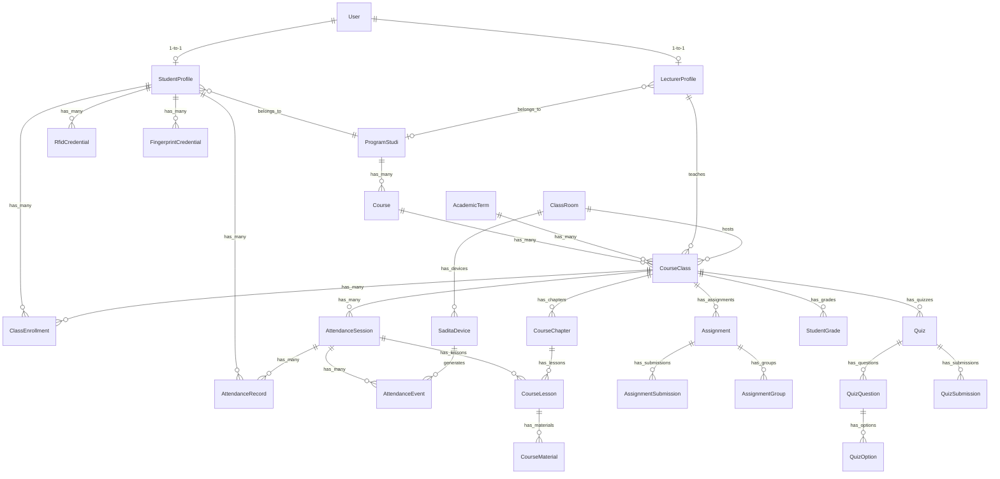
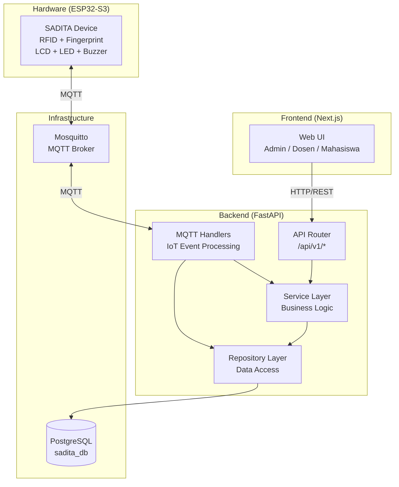
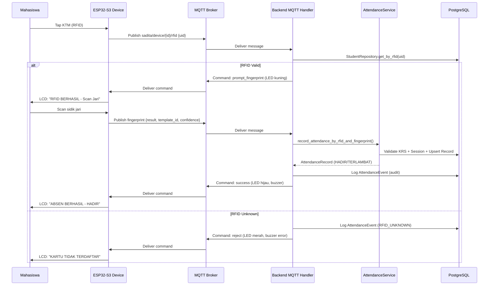
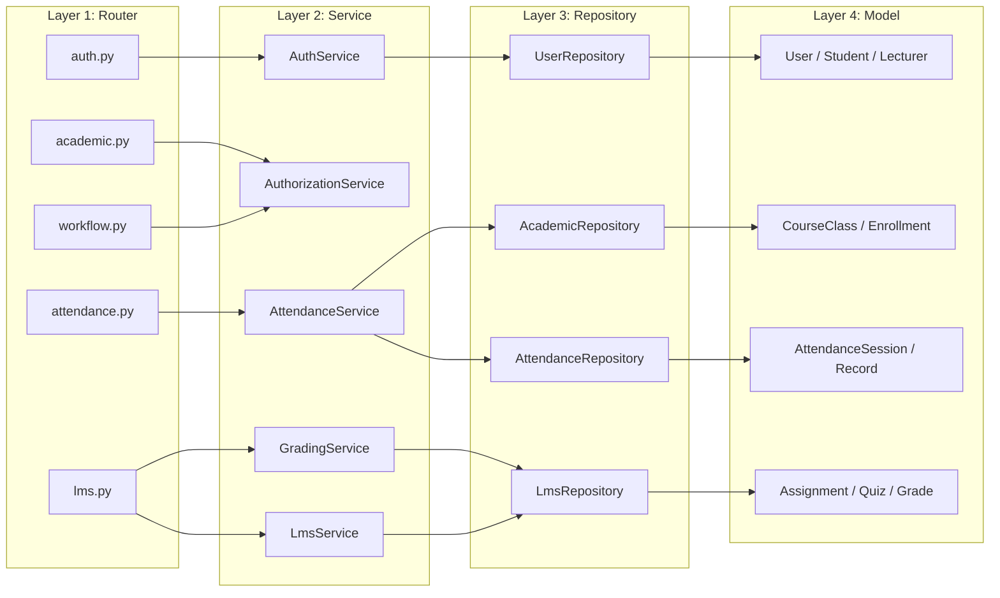

# Arsitektur Sistem Backend SADITA

> **Sistem Absensi Digital Terintegrasi Akademik & LMS — UNIPI**
>
> Dokumen ini menjelaskan **seluruh** sistem backend secara utuh: arsitektur, layer, model data, alur bisnis, protokol IoT, keamanan, dan testing. Ditulis langsung berdasarkan kode sumber aktual di `backend/`.

---

## Daftar Isi

1. [Gambaran Umum](#1-gambaran-umum)
2. [Technology Stack](#2-technology-stack)
3. [Struktur Direktori](#3-struktur-direktori)
4. [Konfigurasi & Environment](#4-konfigurasi--environment)
5. [Database Layer](#5-database-layer)
6. [ORM Models (Domain)](#6-orm-models-domain)
7. [Pydantic Schemas](#7-pydantic-schemas)
8. [Repository Layer](#8-repository-layer)
9. [Service Layer (Business Logic)](#9-service-layer-business-logic)
10. [API Endpoints (Router Layer)](#10-api-endpoints-router-layer)
11. [Autentikasi & Otorisasi (RBAC)](#11-autentikasi--otorisasi-rbac)
12. [MQTT & IoT Pipeline](#12-mqtt--iot-pipeline)
13. [Grading Engine](#13-grading-engine)
14. [Audit Logging](#14-audit-logging)
15. [Database Seeding](#15-database-seeding)
16. [Testing](#16-testing)
17. [Deployment & Lifecycle](#17-deployment--lifecycle)
18. [Diagram Arsitektur](#18-diagram-arsitektur)

---

## 1. Gambaran Umum

SADITA bukan sekadar sistem absensi. SADITA adalah **ekosistem enterprise** yang mengelola:

| Domain | Cakupan |
|---|---|
| **Akademik** | Program Studi, Tahun Akademik, Mata Kuliah, Kelas, Dosen, Mahasiswa, KRS/Enrollment |
| **Presensi** | Sesi pertemuan, status HADIR/TERLAMBAT/IZIN/SAKIT/ALFA, validasi KRS, IoT 2FA (RFID + Fingerprint) |
| **Hardware IoT** | ESP32-S3, RC522 (RFID), sensor fingerprint (AS608), RTC, LCD, LED, buzzer — komunikasi via MQTT |
| **LMS** | Chapter, Lesson, Material, Assignment (individu & kelompok), Quiz, Submission, Progress tracking |
| **Nilai** | Grading engine berbobot (UTS 30%, UAS 35%, Aktif 10%, Tugas 15%, Absen 10%), skala A–E |
| **Workflow** | Approval sesi pengganti, verifikasi ketua kelas, KRS request |
| **Audit** | Immutable audit log dengan IP, User-Agent, before/after snapshot |

Backend memproses **seluruh domain** di atas melalui arsitektur 4-tier Clean Architecture:

```
Router (API) → Service (Business Logic) → Repository (Data Access) → Model (ORM/DB)
```

---

## 2. Technology Stack

| Komponen | Teknologi | Versi |
|---|---|---|
| **Web Framework** | FastAPI | 0.115.14 |
| **ASGI Server** | Uvicorn (standard) | 0.35.0 |
| **ORM** | SQLAlchemy | 2.0.41 |
| **Migration** | Alembic | 1.15.2 |
| **Database** | PostgreSQL | via `asyncpg` 0.30.0 + `psycopg2-binary` 2.9.10 |
| **Validation** | Pydantic v2 | 2.11.4 |
| **Settings** | pydantic-settings | 2.10.1 |
| **Auth (JWT)** | python-jose[cryptography] | 3.5.0 |
| **Password Hash** | bcrypt (via passlib) | — |
| **MQTT** | paho-mqtt | 2.1.0 |
| **Logging** | structlog | 25.4.0 |
| **Testing** | pytest + pytest-asyncio + httpx | 8.4.0 |

---

## 3. Struktur Direktori

```
backend/
├── .env                           # Environment variables (tidak di-commit)
├── .env.example                   # Template environment
├── alembic/                       # Alembic migration engine
│   ├── env.py
│   ├── script.py.mako
│   └── versions/                  # Migration scripts
├── alembic.ini                    # Alembic config
├── requirements.txt               # Python dependencies
├── pyproject.toml
│
├── app/                           # Kode aplikasi utama
│   ├── __init__.py
│   ├── main.py                    # FastAPI app factory + lifespan
│   │
│   ├── core/                      # Konfigurasi & infrastruktur inti
│   │   ├── config.py              # Settings (pydantic-settings, .env)
│   │   ├── deps.py                # Dependency injection & RBAC guards
│   │   └── security.py            # JWT + bcrypt utilities
│   │
│   ├── db/                        # Database layer
│   │   ├── session.py             # Engine, SessionLocal, Base, get_db
│   │   ├── seed.py                # Data seed utama
│   │   └── seed_schedule.py       # Seed jadwal/sesi
│   │
│   ├── models/                    # SQLAlchemy ORM models
│   │   ├── __init__.py            # Registry semua model
│   │   ├── user.py                # User + UserRole enum
│   │   ├── program_studi.py       # ProgramStudi (Prodi)
│   │   ├── student.py             # StudentProfile + KtmStatus
│   │   ├── lecturer.py            # LecturerProfile
│   │   ├── credential.py          # RfidCredential + FingerprintCredential
│   │   ├── academic.py            # AcademicTerm, Course, ClassRoom, CourseClass, ClassEnrollment, KrsRequest
│   │   ├── device.py              # SaditaDevice + DeviceStatus
│   │   ├── attendance.py          # AttendanceSession, AttendanceRecord, AttendanceEvent
│   │   ├── lms.py                 # CourseChapter, CourseLesson, CourseMaterial, Assignment, Quiz, Progress, Grade
│   │   └── workflow.py            # AuditLog, AttendanceRequest, ClassLeaderAssignment
│   │
│   ├── schemas/                   # Pydantic v2 request/response schemas
│   │   ├── academic.py
│   │   ├── attendance.py
│   │   ├── audit.py
│   │   ├── auth.py
│   │   ├── device.py
│   │   ├── lms.py
│   │   ├── user.py
│   │   └── workflow.py
│   │
│   ├── repositories/              # Data access layer (Repository pattern)
│   │   ├── academic_repo.py
│   │   ├── attendance_repo.py
│   │   ├── lms_repo.py
│   │   └── user_repo.py
│   │
│   ├── services/                  # Business logic layer
│   │   ├── auth_service.py        # Login, register, token refresh
│   │   ├── authorization_service.py # Class access, ownership verification, audit helper
│   │   ├── attendance_service.py  # Session lifecycle, IoT attendance pipeline
│   │   ├── grading_service.py     # Kalkulasi nilai berbobot, publication workflow
│   │   ├── lms_service.py         # LMS business rules
│   │   └── user_service.py        # User & profile management
│   │
│   ├── api/                       # HTTP endpoint layer
│   │   └── v1/
│   │       ├── router.py          # Aggregator — menghimpun seluruh sub-router
│   │       └── endpoints/
│   │           ├── health.py      # GET /api/v1/health
│   │           ├── auth.py        # POST login, register, refresh
│   │           ├── users.py       # CRUD users
│   │           ├── students.py    # CRUD student profiles + credentials
│   │           ├── lecturers.py   # CRUD lecturer profiles
│   │           ├── academic.py    # Prodi, term, courses, classes, enrollment, KRS
│   │           ├── attendance.py  # Sessions, records, live attendance
│   │           ├── devices.py     # CRUD SADITA devices
│   │           ├── lms.py         # Chapters, lessons, materials, assignments, quizzes, grades
│   │           ├── workflow.py    # Class leader, attendance requests, approval
│   │           ├── audit.py       # Read-only audit log
│   │           ├── uploads.py     # File upload handler
│   │           └── kobar.py       # SI KOBAR (AI Assistant endpoint)
│   │
│   └── mqtt/                      # MQTT / IoT integration
│       ├── client.py              # SADITAMQTTClient — singleton, lifecycle, publish
│       └── handlers.py            # Event handlers: RFID, fingerprint, status, attendance, ACK
│
├── tests/                         # Test suite
│   ├── conftest.py
│   ├── test_phase1_infrastructure.py
│   ├── test_phase2_auth_and_models.py
│   ├── test_phase3_attendance.py
│   ├── test_phase4_lms.py
│   ├── test_academic_krs_and_auth.py
│   ├── test_pilot_e2e_scenarios.py
│   ├── test_rfid_attendance_e2e.py
│   ├── test_class_leader_workflow.py
│   ├── test_devices_api.py
│   ├── test_uploads_api.py
│   ├── test_audit_api.py
│   └── test_p0_stabilization.py
│
├── uploads/                       # Uploaded files storage
└── scripts/                       # Utility scripts
```

---

## 4. Konfigurasi & Environment

Konfigurasi dikelola melalui kelas `Settings` yang mewarisi `BaseSettings` dari `pydantic-settings`. Semua nilai dibaca dari file `.env` atau environment variable sistem.

### 4.1 Variabel Konfigurasi

| Kategori | Variable | Default | Keterangan |
|---|---|---|---|
| **App** | `APP_NAME` | `SADITA` | Nama aplikasi |
| | `APP_ENV` | `development` | Environment (`development` / `production`) |
| | `APP_DEBUG` | `true` | Mode debug (SQL echo, log level DEBUG) |
| | `SECRET_KEY` | `change-me` | Secret key umum (wajib ≥32 char di production) |
| | `ALLOWED_ORIGINS` | `http://localhost:3000` | CORS origins, dipisah koma |
| **Database** | `POSTGRES_HOST` | `localhost` | Host PostgreSQL |
| | `POSTGRES_PORT` | `5433` | Port PostgreSQL |
| | `POSTGRES_DB` | `sadita_db` | Nama database |
| | `POSTGRES_USER` | `postgres` | User database |
| | `POSTGRES_PASSWORD` | — | Password database |
| | `DATABASE_URL` | (auto-build) | Jika kosong, dirakit dari komponen di atas |
| **JWT** | `JWT_SECRET_KEY` | `change-me-jwt` | Secret key JWT (wajib ≥32 char di production) |
| | `JWT_ALGORITHM` | `HS256` | Algoritma signing |
| | `JWT_ACCESS_TOKEN_EXPIRE_MINUTES` | `60` | Masa berlaku access token (menit) |
| | `JWT_REFRESH_TOKEN_EXPIRE_DAYS` | `7` | Masa berlaku refresh token (hari) |
| **MQTT** | `MQTT_BROKER_HOST` | `localhost` | Host Mosquitto broker |
| | `MQTT_BROKER_PORT` | `1883` | Port MQTT |
| | `MQTT_CLIENT_ID` | `sadita-backend` | Client ID MQTT |
| | `MQTT_TLS_ENABLED` | `false` | TLS/mTLS (production: true) |
| **Upload** | `UPLOAD_DIR` | `uploads` | Direktori penyimpanan file |
| | `MAX_UPLOAD_SIZE_MB` | `10` | Batas ukuran file upload |
| **Policy** | `MIN_ATTENDANCE_PERCENTAGE_FOR_UAS` | `75.0` | Ambang kehadiran minimum untuk UAS |

### 4.2 Validasi Production

Secret key (`SECRET_KEY` dan `JWT_SECRET_KEY`) **wajib** memiliki minimal 32 karakter di environment production. Jika menggunakan default atau string pendek, aplikasi akan menolak startup dengan `ValueError`.

---

## 5. Database Layer

### 5.1 Engine & Session

File: [`app/db/session.py`](file:///c:/Users/Rizal/Documents/Project/Sadita.ai/backend/app/db/session.py)

```python
engine = create_engine(
    settings.DATABASE_URL,
    pool_pre_ping=True,      # Verifikasi koneksi sebelum dipakai
    pool_size=10,             # Connection pool
    max_overflow=20,          # Overflow pool
    echo=settings.APP_DEBUG,  # SQL logging di dev
)

SessionLocal = sessionmaker(
    bind=engine,
    autocommit=False,
    autoflush=False,
    expire_on_commit=False,
)
```

- **`Base`**: `DeclarativeBase` dari SQLAlchemy 2.0 — semua model mewarisi kelas ini.
- **`get_db()`**: FastAPI dependency generator yang menghasilkan session dan menutupnya setelah request.
- **`check_db_connection()`**: Health-check helper yang menjalankan `SELECT version()`.

### 5.2 Migrasi (Alembic)

- Direktori: `backend/alembic/`
- Config: `backend/alembic.ini`
- Di **development**: `Base.metadata.create_all()` dijalankan saat startup (auto-create schema).
- Di **production**: Schema **wajib** dikelola sepenuhnya melalui Alembic migrations.

---

## 6. ORM Models (Domain)

Seluruh model SQLAlchemy 2.0 menggunakan `Mapped` typed columns dan property alias bilingual (Bahasa Indonesia untuk kolom DB, English untuk property aksesibilitas).

### 6.1 Entity Relationship Diagram (Ringkas)



### 6.2 Daftar Model

#### A. User & Identity

| Model | Tabel | Deskripsi |
|---|---|---|
| `User` | `users` | Akun pengguna utama (email, password_hash, full_name, role, is_active) |
| `UserRole` | — | Enum: `ADMIN`, `KAPRODI`, `DOSEN`, `MAHASISWA` |

#### B. Profile

| Model | Tabel | Deskripsi |
|---|---|---|
| `StudentProfile` | `student_profiles` | Profil mahasiswa (NIM, angkatan, prodi, academic_cohort, class_type, ktm_status) |
| `LecturerProfile` | `lecturer_profiles` | Profil dosen (NIDN, gelar_depan, gelar_belakang, prodi) |
| `ProgramStudi` | `program_studi` | Program studi/jurusan (kode, nama, jenjang) |

#### C. Credential (Hardware IoT)

| Model | Tabel | Deskripsi |
|---|---|---|
| `RfidCredential` | `rfid_credentials` | KTM RFID (UID hex, is_active, riwayat) — satu mahasiswa bisa punya banyak, hanya satu aktif |
| `FingerprintCredential` | `fingerprint_credentials` | Slot fingerprint di sensor AS608 (device_id, template_slot, finger_label) — multi-finger |

#### D. Akademik

| Model | Tabel | Deskripsi |
|---|---|---|
| `AcademicTerm` | `academic_terms` | Semester akademik (nama, is_active, tanggal_mulai/selesai) |
| `Course` | `courses` | Mata kuliah (kode, nama, SKS, prodi, semester_ke) |
| `ClassRoom` | `class_rooms` | Ruang kelas/lab (kode, nama, kapasitas, gedung, lantai) |
| `CourseClass` | `course_classes` | Kelas perkuliahan (mata kuliah + semester + dosen + jadwal + tipe) |
| `ClassEnrollment` | `class_enrollments` | KRS: enrollment mahasiswa ke kelas (status, tipe enrollment) |
| `KrsRequest` | `krs_requests` | Permohonan tambah SKS/mengulang (approval workflow) |

**ClassType enum**: `REGULER_PAGI`, `REGULER_MALAM`, `SHIFT`
**EnrollmentStatus enum**: `AKTIF`, `DROP`, `CUTI`, `LULUS`
**EnrollmentType enum**: `REGULER`, `TAMBAH_SKS`, `MENGULANG`

#### E. Device (IoT)

| Model | Tabel | Deskripsi |
|---|---|---|
| `SaditaDevice` | `sadita_devices` | Perangkat ESP32-S3 (device_id, nama, room_id, status, firmware, MAC, IP, last_seen) |
| `DeviceStatus` | — | Enum: `ACTIVE`, `INACTIVE`, `MAINTENANCE`, `OFFLINE` |

#### F. Attendance (Presensi)

| Model | Tabel | Deskripsi |
|---|---|---|
| `AttendanceSession` | `attendance_sessions` | Sesi pertemuan (class_id, pertemuan_ke, tanggal, status, scheduled_start_at, delay_minutes/reason) |
| `AttendanceRecord` | `attendance_records` | Status kehadiran **final** (session_id, student_id, status, method, check_in_time) |
| `AttendanceEvent` | `attendance_events` | Raw event log IoT — **audit trail** (device_id, event_type, rfid_uid, fingerprint_slot, confidence) |

**SessionStatus**: `SCHEDULED` → `OPEN` → `CLOSED`
**AttendanceStatus**: `HADIR`, `TERLAMBAT`, `IZIN`, `SAKIT`, `ALFA`
**AttendanceMethod**: `RFID_FINGERPRINT`, `FINGERPRINT_ONLY`, `MANUAL_DOSEN`, `MANUAL_ADMIN`
**AttendanceEventType**: `RFID_SCAN`, `FINGERPRINT_MATCH`, `FINGERPRINT_FAIL`, `RFID_UNKNOWN`, `ATTENDANCE_RECORDED`, `DEVICE_HEARTBEAT`

#### G. LMS (Learning Management System)

| Model | Tabel | Deskripsi |
|---|---|---|
| `CourseChapter` | `course_chapters` | Bab/modul dalam kelas (title, chapter_number, is_published) |
| `CourseLesson` | `course_lessons` | Lesson per chapter (lesson_type: DOCUMENT/VIDEO/QUIZ/ASSIGNMENT/EXERCISE) |
| `CourseMaterial` | `course_materials` | Lampiran/materi (material_type: DOCUMENT/LINK/TEXT/VIDEO/SCORM) |
| `Assignment` | `assignments` | Tugas (individu/kelompok, due_date, max_score, allow_late) |
| `AssignmentSubmission` | `assignment_submissions` | Submission mahasiswa (file_url, content, score, feedback, status) |
| `AssignmentGroup` | `assignment_groups` | Kelompok tugas (assignment_id, name, leader_id) |
| `AssignmentGroupMember` | `assignment_group_members` | Anggota kelompok |
| `Quiz` | `quizzes` | Kuis (passing_score, max_attempts, time_limit, shuffle_questions) |
| `QuizQuestion` | `quiz_questions` | Pertanyaan (question_type: SINGLE/MULTIPLE/TEXT/TRUE_FALSE/SHORT_ANSWER/ESSAY) |
| `QuizOption` | `quiz_options` | Pilihan jawaban (option_text, is_correct) |
| `QuizSubmission` | `quiz_submissions` | Submission kuis (attempt_number, score, passed) |
| `QuizAnswer` | `quiz_answers` | Jawaban per soal |
| `LessonProgress` | `lesson_progress` | Progress mahasiswa per lesson |
| `CourseProgress` | `course_progress` | Progress total per kelas |
| `StudentGrade` | `student_grades` | Nilai komponen & final (UTS, UAS, Aktif, Tugas, Absen → final_score, grade_scale A–E) |
| `ClassGradeConfig` | `class_grade_configs` | Konfigurasi bobot nilai per kelas |

**KtmStatus enum**: `BELUM_MEMILIKI_KTM`, `KTM_TERDAFTAR`, `KTM_HILANG`, `KTM_TIDAK_DIBAWA`
**GradeScale**: A (≥85), B (≥75), C (≥65), D (≥55), E (<55)

#### H. Workflow

| Model | Tabel | Deskripsi |
|---|---|---|
| `AuditLog` | `audit_logs` | Log audit imutabel (actor_id, action, entity, before/after JSON, IP, User-Agent) |
| `AttendanceRequest` | `attendance_requests` | Permohonan presensi pengganti (PENDING → VERIFIED → APPROVED/REJECTED) |
| `ClassLeaderAssignment` | `class_leader_assignments` | Penugasan ketua kelas (class_id, student_id, is_active) |

---

## 7. Pydantic Schemas

Schemas didefinisikan dalam `app/schemas/` menggunakan Pydantic v2 (`model_validate`, `model_config`). Setiap domain memiliki schema terpisah:

| File | Cakupan |
|---|---|
| `auth.py` | `LoginRequest`, `RegisterRequest`, `TokenResponse`, `RefreshRequest` |
| `user.py` | `UserResponse`, `UserCreate`, `StudentProfileCreate`, `LecturerProfileCreate` |
| `academic.py` | Schema untuk Term, Course, ClassRoom, CourseClass, Enrollment, KrsRequest |
| `attendance.py` | Schema untuk Session, Record, Event, Summary |
| `device.py` | Schema untuk SaditaDevice CRUD |
| `lms.py` | Schema untuk Chapter, Lesson, Material, Assignment, Quiz, Submission, Grade |
| `audit.py` | Schema untuk AuditLog read |
| `workflow.py` | Schema untuk AttendanceRequest, ClassLeaderAssignment |

---

## 8. Repository Layer

Repository layer mengenkapsulasi semua **akses data** — query, insert, update. Tidak ada business logic di sini. Tidak ada query langsung di Router.

| Repository | File | Tanggung Jawab |
|---|---|---|
| `UserRepository` | [`user_repo.py`](file:///c:/Users/Rizal/Documents/Project/Sadita.ai/backend/app/repositories/user_repo.py) | CRUD User, get_by_email, get_by_id |
| `StudentRepository` | [`user_repo.py`](file:///c:/Users/Rizal/Documents/Project/Sadita.ai/backend/app/repositories/user_repo.py) | CRUD StudentProfile, get_by_nim, **get_by_rfid**, **get_by_fingerprint_id**, get_by_user_id |
| `LecturerRepository` | [`user_repo.py`](file:///c:/Users/Rizal/Documents/Project/Sadita.ai/backend/app/repositories/user_repo.py) | CRUD LecturerProfile, get_by_nidn, get_by_user_id |
| `AcademicRepository` | [`academic_repo.py`](file:///c:/Users/Rizal/Documents/Project/Sadita.ai/backend/app/repositories/academic_repo.py) | CRUD Term/Course/ClassRoom/CourseClass/Enrollment, get_enrollments, get_class_by_id |
| `AttendanceRepository` | [`attendance_repo.py`](file:///c:/Users/Rizal/Documents/Project/Sadita.ai/backend/app/repositories/attendance_repo.py) | CRUD Session/Record, create_session, open_session, close_session, **upsert_record**, bulk_initialize_records, get_open_session_for_class |
| `LmsRepository` | [`lms_repo.py`](file:///c:/Users/Rizal/Documents/Project/Sadita.ai/backend/app/repositories/lms_repo.py) | CRUD Chapter/Lesson/Material/Assignment/Quiz/Submission/Progress/Grade |

### Metode Kunci

- **`StudentRepository.get_by_rfid(db, uid)`** — Mencari mahasiswa berdasarkan RFID UID. Digunakan oleh MQTT handler dan attendance service.
- **`StudentRepository.get_by_fingerprint_id(db, template_id)`** — Mencari mahasiswa berdasarkan slot fingerprint. Mendukung mode `BELUM_MEMILIKI_KTM`.
- **`AttendanceRepository.upsert_record()`** — Idempotent: jika record sudah ada untuk (session, student), update; jika belum, insert.
- **`AttendanceRepository.bulk_initialize_records()`** — Saat sesi OPEN, buat record `ALFA` untuk semua mahasiswa enrolled yang belum punya record.

---

## 9. Service Layer (Business Logic)

Service layer mengandung **seluruh logika bisnis**. Tidak ada logika domain di Router atau Repository.

### 9.1 `AuthService`

File: [`auth_service.py`](file:///c:/Users/Rizal/Documents/Project/Sadita.ai/backend/app/services/auth_service.py)

| Method | Fungsi |
|---|---|
| `authenticate(db, email, password)` | Login via email atau NIM + password. Validasi is_active. |
| `create_token_response(user)` | Generate JWT access + refresh token pair. |
| `refresh(db, refresh_token)` | Validasi refresh token, issue token pair baru. |
| `register(db, req)` | Register user + auto-create profile (Student/Lecturer) berdasarkan role. Validasi NIM/NIDN unik. |

### 9.2 `AuthorizationService`

File: [`authorization_service.py`](file:///c:/Users/Rizal/Documents/Project/Sadita.ai/backend/app/services/authorization_service.py)

| Function | Fungsi |
|---|---|
| `require_class_access(db, user, class_id, *, leader)` | Verifikasi akses user ke kelas: ADMIN=full, KAPRODI=prodi sendiri, DOSEN=kelas sendiri, MAHASISWA=enrolled/leader |
| `require_own_student_data(db, user, student_id)` | MAHASISWA hanya bisa akses data sendiri |
| `audit(db, actor_id, action, entity, ...)` | Helper untuk menulis immutable audit log |

> **BR-ROLE-008**: Unauthorized access mengembalikan 404 (bukan 403) untuk menyembunyikan eksistensi resource.

### 9.3 `AttendanceService`

File: [`attendance_service.py`](file:///c:/Users/Rizal/Documents/Project/Sadita.ai/backend/app/services/attendance_service.py)

#### Session Lifecycle

```
SCHEDULED ──(open_session)──→ OPEN ──(close_session)──→ CLOSED
```

| Method | Fungsi |
|---|---|
| `create_session(db, class_id, session_number, date, topic)` | Buat sesi terjadwal (validasi class exists, session_number 1–16, no duplicate) |
| `open_session(db, session_id, ...)` | Buka sesi: hitung delay (PO-04), validasi alasan jika delay >10 menit, initialize ALFA records untuk semua enrolled students |
| `close_session(db, session_id)` | Tutup sesi: backfill ALFA untuk enrolled students tanpa record (BR-ATT-007) |
| `manual_update(db, session_id, student_id, new_status, notes)` | Koreksi manual oleh dosen |
| `get_session_summary(db, session_id)` | Statistik: total, hadir, terlambat, izin, sakit, alfa |
| `calculate_student_attendance_summary(db, student_id, class_id)` | Persentase kehadiran + soft warning UAS (PO-01) |

#### IoT Attendance Pipeline

```python
record_attendance_by_rfid_and_fingerprint(
    db, rfid_uid, fingerprint_template_id, confidence, event_timestamp, session_id
)
```

**Alur:**
1. Lookup student by RFID UID
2. Verify fingerprint matches student credential (if 2FA)
3. Reject jika confidence < 40%
4. Auto-detect sesi OPEN (atau gunakan session_id eksplisit)
5. Hitung status: `HADIR` jika ≤ batas terlambat, `TERLAMBAT` jika lewat
6. Upsert attendance record (idempotent)

**Penentuan Status Kehadiran (PO-04):**
- `effective_start` = `max(scheduled_start_at, opened_at)` — acuan awal presensi menggunakan waktu yang **lebih akhir** antara jadwal resmi dan waktu aktual sesi dibuka
- `late_cutoff` = `effective_start + batas_terlambat_menit` (default: 15 menit)
- Check-in ≤ late_cutoff → `HADIR`
- Check-in > late_cutoff → `TERLAMBAT`

### 9.4 `GradingService`

File: [`grading_service.py`](file:///c:/Users/Rizal/Documents/Project/Sadita.ai/backend/app/services/grading_service.py)

*(Lihat bagian [13. Grading Engine](#13-grading-engine) untuk detail lengkap)*

### 9.5 `LmsService`

File: [`lms_service.py`](file:///c:/Users/Rizal/Documents/Project/Sadita.ai/backend/app/services/lms_service.py)

Mengelola logika bisnis untuk:
- Chapter & Lesson CRUD + publish workflow
- Material attachment management
- Assignment creation, submission, grading
- Quiz lifecycle: create, submit, auto-grade multiple choice
- Progress tracking (lesson-level dan course-level)

### 9.6 `UserService`

File: [`user_service.py`](file:///c:/Users/Rizal/Documents/Project/Sadita.ai/backend/app/services/user_service.py)

Mengelola CRUD user dan profile (student/lecturer) dengan validasi bisnis.

---

## 10. API Endpoints (Router Layer)

Semua endpoint di-prefix dengan `/api/v1`. Router aggregator di [`app/api/v1/router.py`](file:///c:/Users/Rizal/Documents/Project/Sadita.ai/backend/app/api/v1/router.py).

### 10.1 Daftar Endpoint Groups

| Router File | Prefix/Tag | Jumlah Endpoint | Deskripsi |
|---|---|---|---|
| `health.py` | `/health` | 1 | Health check (DB + MQTT status) |
| `auth.py` | `/auth` | 3 | Login, register, refresh token |
| `users.py` | `/users` | 2+ | User listing, current user |
| `students.py` | `/students` | 5+ | CRUD student profiles + credentials |
| `lecturers.py` | `/lecturers` | 2+ | CRUD lecturer profiles |
| `academic.py` | `/academic` | 20+ | Prodi, term, course, class, classroom, enrollment, KRS |
| `attendance.py` | `/attendance` | 10+ | Sessions, records, live attendance, manual update, summary |
| `devices.py` | `/devices` | 5+ | CRUD SADITA devices |
| `lms.py` | `/lms` | 30+ | Chapters, lessons, materials, assignments, quizzes, submissions, grades |
| `workflow.py` | `/workflow` | 8+ | Class leader, attendance requests, approval |
| `audit.py` | `/audit` | 1 | Read-only audit log |
| `uploads.py` | `/uploads` | 2 | File upload & retrieval |
| `kobar.py` | `/kobar` | 3+ | SI KOBAR AI assistant |

### 10.2 Endpoint Utama

#### Authentication
```
POST   /api/v1/auth/login       → TokenResponse
POST   /api/v1/auth/register    → TokenResponse
POST   /api/v1/auth/refresh     → TokenResponse
```

#### Academic
```
GET    /api/v1/academic/prodi                    → List[Prodi]
POST   /api/v1/academic/prodi                    → Prodi
GET    /api/v1/academic/terms                    → List[Term]
POST   /api/v1/academic/terms                    → Term
GET    /api/v1/academic/courses                  → List[Course]
POST   /api/v1/academic/courses                  → Course
GET    /api/v1/academic/classrooms               → List[ClassRoom]
POST   /api/v1/academic/classrooms               → ClassRoom
GET    /api/v1/academic/classes                  → List[CourseClass]
POST   /api/v1/academic/classes                  → CourseClass
GET    /api/v1/academic/classes/{id}/enrollments → List[Enrollment]
POST   /api/v1/academic/enrollments              → Enrollment
POST   /api/v1/academic/krs-requests             → KrsRequest
```

#### Attendance
```
POST   /api/v1/attendance/sessions                        → AttendanceSession
POST   /api/v1/attendance/sessions/{id}/open               → AttendanceSession
POST   /api/v1/attendance/sessions/{id}/close              → AttendanceSession
GET    /api/v1/attendance/sessions/{id}/records             → List[Record]
GET    /api/v1/attendance/sessions/{id}/summary             → Summary
PUT    /api/v1/attendance/records/{id}                     → Record (manual update)
GET    /api/v1/attendance/students/{id}/summary             → AttendanceSummary
```

#### LMS
```
POST   /api/v1/lms/classes/{id}/chapters                  → Chapter
GET    /api/v1/lms/classes/{id}/chapters                  → List[Chapter]
POST   /api/v1/lms/chapters/{id}/lessons                  → Lesson
POST   /api/v1/lms/lessons/{id}/materials                 → Material
POST   /api/v1/lms/classes/{id}/assignments               → Assignment
POST   /api/v1/lms/assignments/{id}/submissions            → Submission
PUT    /api/v1/lms/submissions/{id}/grade                 → Submission (graded)
POST   /api/v1/lms/classes/{id}/quizzes                   → Quiz
POST   /api/v1/lms/quizzes/{id}/submit                    → QuizSubmission
GET    /api/v1/lms/classes/{id}/grades                    → List[StudentGrade]
POST   /api/v1/lms/classes/{id}/grades/calculate           → List[StudentGrade]
```

---

## 11. Autentikasi & Otorisasi (RBAC)

### 11.1 Autentikasi (JWT)

File: [`app/core/security.py`](file:///c:/Users/Rizal/Documents/Project/Sadita.ai/backend/app/core/security.py)

- **Password hashing**: bcrypt (truncated to 72 bytes)
- **Access Token**: JWT HS256, expire 60 menit, type=`access`, subject=`user.id`
- **Refresh Token**: JWT HS256, expire 7 hari, type=`refresh`, subject=`user.id`
- **Flow**: Login → Access Token + Refresh Token → Access Token di header `Authorization: Bearer <token>` → Refresh saat expire

### 11.2 RBAC (Role-Based Access Control)

File: [`app/core/deps.py`](file:///c:/Users/Rizal/Documents/Project/Sadita.ai/backend/app/core/deps.py)

#### Role Hierarchy

| Role | Kode | Hak Akses |
|---|---|---|
| `ADMIN` | Pengelola sistem | Full access ke semua resource |
| `KAPRODI` | Ketua Program Studi | Akses data prodi sendiri + approval |
| `DOSEN` | Dosen pengajar | Akses kelas yang diajar + kelola presensi, materi, tugas, nilai |
| `MAHASISWA` | Mahasiswa | Akses data sendiri + kelas yang diikuti |

#### Dependency Injection Guards

```python
# Type aliases yang bisa langsung dipakai di parameter endpoint:
DBSession     = Annotated[Session, Depends(get_db)]
CurrentUser   = Annotated[User, Depends(get_current_user)]
RequireAdmin  = Annotated[User, Depends(require_roles(UserRole.ADMIN))]
RequireLecturer = Annotated[User, Depends(require_roles(UserRole.ADMIN, UserRole.DOSEN))]
RequireStudent  = Annotated[User, Depends(require_roles(UserRole.ADMIN, UserRole.MAHASISWA))]
RequireKaprodi  = Annotated[User, Depends(require_roles(UserRole.ADMIN, UserRole.KAPRODI))]
RequireAcademicStaff = Annotated[User, Depends(require_roles(UserRole.ADMIN, UserRole.KAPRODI, UserRole.DOSEN))]
RequireAny    = Annotated[User, Depends(require_roles(ADMIN, KAPRODI, DOSEN, MAHASISWA))]
```

#### Service-Level Authorization

Selain role check di endpoint, akses granular divalidasi di service layer:
- **`require_class_access()`** — Verifikasi user boleh mengakses kelas tertentu (ADMIN=all, DOSEN=yang diajar, MAHASISWA=yang diikuti)
- **`require_own_student_data()`** — MAHASISWA hanya bisa mengakses data dirinya sendiri (anti-IDOR)
- **Ketua Kelas** — Bukan role terpisah, melainkan MAHASISWA dengan assignment aktif di `class_leader_assignments`

---

## 12. MQTT & IoT Pipeline

### 12.1 MQTT Client

File: [`app/mqtt/client.py`](file:///c:/Users/Rizal/Documents/Project/Sadita.ai/backend/app/mqtt/client.py)

`SADITAMQTTClient` adalah singleton yang mengelola koneksi persisten ke Mosquitto broker.

**Fitur:**
- MQTTv5 protocol
- Thread pool (8 worker) untuk dispatch event handler secara paralel
- Auto-reconnect (via paho-mqtt loop)
- Graceful teardown saat shutdown

### 12.2 Topic Schema

```
sadita/device/{device_id}/status       ← Device heartbeat/status
sadita/device/{device_id}/rfid         ← RFID scan event
sadita/device/{device_id}/fingerprint  ← Fingerprint verification result
sadita/device/{device_id}/attendance   ← Combined attendance event
sadita/device/{device_id}/command      → Backend command ke device
sadita/device/{device_id}/ack          ← Device acknowledgement
```

Backend subscribe ke wildcard: `sadita/device/+/#`

### 12.3 Event Handlers

File: [`app/mqtt/handlers.py`](file:///c:/Users/Rizal/Documents/Project/Sadita.ai/backend/app/mqtt/handlers.py)

#### `handle_status(device_id, payload)`
- Update `last_seen_at` dan `status` = `ACTIVE` di database
- Update `firmware_version` jika tersedia

#### `handle_rfid(device_id, payload)`

**Alur Lengkap:**

```
ESP32 tap KTM
  ↓
MQTT: sadita/device/{id}/rfid  {uid: "A1B2C3D4"}
  ↓
Backend: StudentRepository.get_by_rfid(uid)
  ↓
┌─ Tidak ditemukan:
│   → Log AttendanceEvent (RFID_UNKNOWN)
│   → Command: {action: "reject", led: "RED", buzzer: "ERROR", lcd: "KARTU TIDAK TERDAFTAR"}
│
└─ Ditemukan:
    → Log AttendanceEvent (RFID_SCAN)
    ↓
    ┌─ Mode 1FA (rfid_only):
    │   → AttendanceService.record_attendance_by_rfid_and_fingerprint()
    │   → Command: {action: "success", led: "GREEN", buzzer: "SUCCESS", lcd: "ABSEN BERHASIL"}
    │
    └─ Mode 2FA (default):
        → Command: {action: "prompt_fingerprint", led: "YELLOW", buzzer: "BEEP_SHORT", lcd: "RFID BERHASIL"}
        → ESP32 meminta scan fingerprint
```

#### `handle_fingerprint(device_id, payload)`

**Alur Lengkap:**

```
ESP32 scan sidik jari
  ↓
MQTT: sadita/device/{id}/fingerprint  {result, template_id, confidence, rfid_uid}
  ↓
┌─ result ≠ "match" atau template_id = null:
│   → Log (FINGERPRINT_FAIL)
│   → Command: {action: "reject", lcd: "SIDIK JARI SALAH"}
│
└─ result = "match":
    → Cari student by rfid_uid ATAU by template_id (BELUM_MEMILIKI_KTM)
    ↓
    ┌─ Student tidak ditemukan:
    │   → Command: {action: "reject", lcd: "DATA MAHASISWA TIDAK DITEMUKAN"}
    │
    └─ Student ditemukan:
        → Validasi template_slot cocok dengan credential student
        → Tentukan method: RFID_FINGERPRINT atau FINGERPRINT_ONLY
        → AttendanceService.record_attendance_by_rfid_and_fingerprint()
        ↓
        ┌─ Sukses:
        │   → Log (ATTENDANCE_RECORDED)
        │   → Command: {action: "success", attendance_status, nim, check_in_time}
        │
        └─ Gagal (validasi KRS/sesi):
            → Command: {action: "reject", reason: error_message}
```

### 12.4 Command Payload ke Device

Backend mengirim command via MQTT topic `sadita/device/{device_id}/command` dengan format:

```json
{
  "action": "success" | "reject" | "prompt_fingerprint",
  "status": "ABSEN_BERHASIL" | "RFID_UNKNOWN" | "FINGERPRINT_FAIL" | ...,
  "lcd_line1": "ABSEN BERHASIL",
  "lcd_line2": "2401001 HADIR",
  "led": "GREEN" | "RED" | "YELLOW",
  "buzzer": "SUCCESS" | "ERROR" | "BEEP_SHORT",
  "nim": "2401001",
  "student_name": "Budi Santoso",
  "check_in_time": "08:05:23"
}
```

---

## 13. Grading Engine

File: [`app/services/grading_service.py`](file:///c:/Users/Rizal/Documents/Project/Sadita.ai/backend/app/services/grading_service.py)

### 13.1 Bobot Nilai Default

| Komponen | Bobot | Keterangan |
|---|---|---|
| UTS | 30% | Ujian Tengah Semester |
| UAS | 35% | Ujian Akhir Semester |
| Aktif | 10% | Keaktifan (default: 80, bisa di-override dosen) |
| Tugas | 15% | Rata-rata nilai tugas |
| Absen | 10% | Persentase kehadiran (auto-calculated) |

**Formula**: `final_score = Σ (score_i × weight_i)`

### 13.2 Skala Nilai

| Grade | Range |
|---|---|
| A | ≥ 85 |
| B | ≥ 75 |
| C | ≥ 65 |
| D | ≥ 55 |
| E | < 55 |

### 13.3 Fitur

| Method | Fungsi |
|---|---|
| `get_or_create_config(db, class_id)` | Ambil atau buat konfigurasi bobot per kelas |
| `update_config(...)` | Update bobot (validasi total = 100%) |
| `get_or_create_grade(db, class_id, student_id)` | Ambil atau buat grade record dengan default aktif score |
| `calculate_attendance_score(db, class_id, student_id)` | Hitung skor kehadiran: (HADIR + TERLAMBAT) / total × 100 |
| `calculate_final_grade(grade, config)` | Hitung nilai akhir dari komponen + bobot |
| `update_component_score(...)` | Update satu komponen + recalculate. Post-publication: wajib alasan revisi |
| `calculate_all_for_class(db, class_id, user_id)` | Kalkulasi batch untuk seluruh mahasiswa enrolled |
| `publish_class_grades(db, class_id, user_id, is_published)` | Publikasi/unpublish nilai ke mahasiswa |

### 13.4 Post-Publication Audit

Setelah nilai dipublikasi (`is_published = True`), setiap perubahan komponen **wajib** menyertakan `reason` yang dicatat di `revision_reason` dan `revision_requested_at` untuk audit trail.

---

## 14. Audit Logging

### 14.1 Immutable Audit Log

Model: `AuditLog` (tabel `audit_logs`, **append-only**)

| Kolom | Tipe | Deskripsi |
|---|---|---|
| `actor_id` | FK → users | Siapa yang melakukan aksi |
| `action` | String(80) | Jenis aksi (e.g., `attendance.manual_update`, `grade.revise`) |
| `entity` | String(80) | Entitas target (e.g., `AttendanceRecord`, `StudentGrade`) |
| `entity_id` | Integer | ID entitas |
| `before` | JSON | Snapshot data **sebelum** perubahan |
| `after` | JSON | Snapshot data **sesudah** perubahan |
| `reason` | Text | Alasan perubahan |
| `ip_address` | String(45) | IP address aktor (dari Request) |
| `user_agent` | String(500) | User-Agent browser/client |
| `created_at` | Timestamptz | Waktu pencatatan |

### 14.2 IoT Event Log

Model: `AttendanceEvent` (tabel `attendance_events`) — mencatat **setiap** event raw dari perangkat ESP32 via MQTT. Terpisah dari `AttendanceRecord` yang menyimpan status final.

---

## 15. Database Seeding

### 15.1 `seed.py`
File: [`app/db/seed.py`](file:///c:/Users/Rizal/Documents/Project/Sadita.ai/backend/app/db/seed.py)

Seed data utama:
- Admin user default
- Program Studi (Teknik Informatika, dll.)
- Dosen dan mahasiswa sampel
- Mata kuliah dan kelas
- RFID & fingerprint credentials
- SADITA devices

### 15.2 `seed_schedule.py`
File: [`app/db/seed_schedule.py`](file:///c:/Users/Rizal/Documents/Project/Sadita.ai/backend/app/db/seed_schedule.py)

Seed data jadwal:
- Attendance sessions (sesi pertemuan 1–16)
- Enrollment data
- Sample attendance records

---

## 16. Testing

### 16.1 Test Suite

Framework: **pytest** + **httpx** (TestClient)

| Test File | Cakupan |
|---|---|
| `test_phase1_infrastructure.py` | Database connection, model creation, basic CRUD |
| `test_phase2_auth_and_models.py` | Authentication, JWT, user registration, profile creation |
| `test_phase3_attendance.py` | Session lifecycle, IoT pipeline, HADIR/TERLAMBAT logic, manual update |
| `test_phase4_lms.py` | LMS CRUD, submission, grading, progress tracking |
| `test_academic_krs_and_auth.py` | KRS request workflow, academic CRUD, RBAC validation |
| `test_pilot_e2e_scenarios.py` | Full end-to-end scenarios: login → enroll → attend → submit → grade |
| `test_rfid_attendance_e2e.py` | RFID → fingerprint → attendance record E2E |
| `test_class_leader_workflow.py` | Ketua kelas assignment + verification flow |
| `test_devices_api.py` | Device CRUD API |
| `test_uploads_api.py` | File upload/download |
| `test_audit_api.py` | Audit log read API |
| `test_p0_stabilization.py` | Regression + stability tests |

### 16.2 Menjalankan Test

```bash
cd backend
pytest -v
pytest -v tests/test_phase3_attendance.py    # Spesifik file
pytest -v -k "test_rfid"                     # Filter by name
pytest --cov=app --cov-report=term-missing   # Coverage report
```

---

## 17. Deployment & Lifecycle

### 17.1 Application Startup (Lifespan)

File: [`app/main.py`](file:///c:/Users/Rizal/Documents/Project/Sadita.ai/backend/app/main.py)

```python
@asynccontextmanager
async def lifespan(app: FastAPI):
    # ---- Startup ----
    ensure_database_ready()    # Schema + seed (dev only: create_all)
    register_all_handlers()    # MQTT event handlers
    mqtt_client.setup()        # Connect to Mosquitto
    yield
    # ---- Shutdown ----
    mqtt_client.teardown()     # Graceful MQTT disconnect
```

**Urutan startup:**
1. Logging configuration (DEBUG di dev, INFO di prod)
2. Database bootstrap (`create_all` di dev, seed data)
3. MQTT handler registration
4. MQTT client connect
5. Serve requests

### 17.2 Middleware

- **CORS**: Mengizinkan frontend origins dari `ALLOWED_ORIGINS`
- Methods: `*`, Headers: `*`, Credentials: `true`

### 17.3 Menjalankan Server

```bash
cd backend
pip install -r requirements.txt
uvicorn app.main:app --reload --host 0.0.0.0 --port 8000
```

**API Documentation:**
- Swagger UI: `http://localhost:8000/docs`
- ReDoc: `http://localhost:8000/redoc`
- OpenAPI JSON: `http://localhost:8000/openapi.json`

---

## 18. Diagram Arsitektur

### 18.1 High-Level Architecture



### 18.2 Attendance Flow (End-to-End)



### 18.3 Four-Tier Architecture



---

> **Dokumen ini adalah dokumen hidup (living documentation).** Setiap perubahan pada kode backend wajib disertai pembaruan pada dokumen ini sesuai dengan [Protokol Mutlak Pengembang §0](file:///c:/Users/Rizal/Documents/Project/Sadita.ai/.agents/AGENTS.md).
